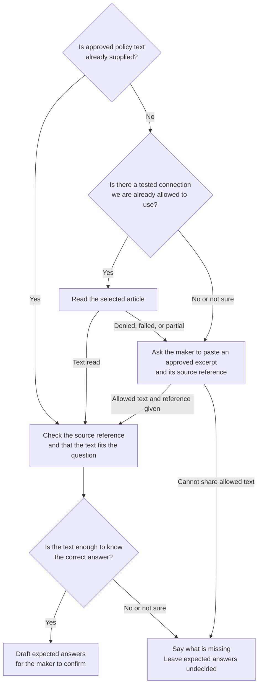

# ServiceNow knowledge evaluations: engineering implementation spec

**Status:** Engineering draft. This is not an approved API design and not a delivery promise.

**Based on the PM spec:** [Test employee knowledge answers with ADK, PR 5771115](https://dev.azure.com/O365Exchange/O365%20Core/_git/ideas-exp/pullrequest/5771115?_a=PlannerEngineering.easy-markdown-review.markdown-review-pr-tab&path=/specs/ess/adk-evals/spec.md), revision 13, PR iteration 23, commit `10f808c1c0d379a87bd9818235f4f155d83ae235`.

**Based on the code:** Local ADK checkout at `fbf9a28ef3d8ec784723f5e8f42d1f23bf1a0378`, checked on November 2, 2026. Unrelated authentication changes in that checkout are not part of this design.

## 1. Purpose and labels

This document explains how engineering plans to build the first ServiceNow knowledge journey in the PM spec. If this document and the PM spec disagree, the PM spec wins.

Each item uses one of three labels:

- **Required:** The PM spec says we must do this.
- **Proposed:** Our engineering plan. It does not exist in the code yet.
- **Open:** We do not know this yet. It needs proof or a decision. Do not guess a value or act as if it already works.

The PM spec is marked `ready: false`. This document does not close any of its approval steps.

### Words used in this document

| Word | Meaning here |
| --- | --- |
| Maker | The person building and testing the agent in ADK. |
| Test case (or case) | One employee question plus the answer we expect the agent to give. |
| Evaluation set (or set) | A group of test cases saved together and run together. |
| KB | A ServiceNow knowledge base: a collection of articles. |
| Article | One published ServiceNow knowledge page. The original published article is the source of truth for policy. |
| Excerpt | The part of an article that answers the question being tested, including any conditions and exceptions. It is copied text, not a separate file. |
| Source reference | A link, article number, or other ID that points to where the excerpt came from. |
| Policy basis | The approved text the expected answer is based on. It must come from the article, not from the agent's own reply. "Independent" means independent of the agent's answer. It can still be inside the agent's KB. |
| Caller | Another ADK workflow (here, a ServiceNow setup workflow) that offers to start evaluations and gets a result back. |
| Handback | The result the evaluation flow returns to the caller. |
| Provenance record | A saved note of where each expected answer came from and who confirmed it, and for which exact version of the test. |
| Fingerprint | A short code computed from a test's exact content. If the test changes, the code changes. Used to spot edits. |
| Reader / adapter | Code that reads an article automatically through a connection that already exists and is already allowed. |
| No-write check | Proof that the agent under test cannot change data in business systems (for example, cannot create tickets). |
| Native run | Running tests through Copilot Studio's built-in evaluation service. |
| Nonproduction | A test environment, not the one real employees use. |
| Duplicate start | Accidentally starting the same test run twice, for example after a timeout and retry. |
| OQ-*n*, FR-*n*, PR-*n* | Open question, functional requirement, and product requirement numbers from the PM spec. |

## 2. Scope and agreed direction

### In scope

- Extend the existing evaluation skills and their Python helper scripts.
- Keep the current ways to start: plain-language requests and `/evaluate`. Add no new command.
- Build the shared entry and result format so a ServiceNow workflow (the caller) can use it later. The automatic offer itself is deferred (see section 5.2).
- Write single-question tests based on approved policy.
- Let the maker review, edit, confirm, and save the tests they choose.
- Keep "is this a good test?" separate from "did the agent pass?"
- Run tests through the existing Copilot Studio evaluation path.
- Read real agent replies, and rerun the same tests after someone fixes the agent elsewhere.
- Keep current access rules, data rules, recovery behavior, and existing features working.

### Out of scope

- Building or turning on ServiceNow connector setup.
- An automatic "Do you want to test this?" offer after ServiceNow setup. PM decision: add it when an active ADK flow exists to attach it to.
- A feature on/off switch. PM decision: ship to everyone.
- Watching for changes made outside ADK, scheduled scans, Planner triggers, or push notifications.
- Scanning every KB or listing every untested integration.
- Multi-turn conversations, per-turn control, or business tasks (like creating tickets).
- Automatic diagnosis or repair, citation grading, advanced matching across copies, or release gates.
- A new reviewer role, notification service, or shared store of prompts and replies.
- New permissions, or reusing the connector's crawler or admin accounts.

### Decisions made in our discussion

| Topic | Decision |
| --- | --- |
| Source of truth | The approved policy in the original published ServiceNow article. That article can be in the agent's own KB. A separate policy store is not needed. |
| Automatic reading | Only through a connection that already exists, is already allowed, and has been tested. Otherwise, ask the maker to paste an approved excerpt and its source reference. |
| Confirmation | Show every generated test in full. Offer both "confirm all shown" and "review one by one". Editing a test means confirming only that test again, not the whole set. No limit on how many tests "confirm all shown" covers; revisit if design review or testing shows one is needed. PM approved the behavior. UX goes to design review; who signs off is still to be confirmed. |
| Where tests are saved | In a matching evaluation set the maker picks, or in a new set tied to the selected agent. Save the source and confirmation details next to the tests. |
| What we save locally | Save the smallest relevant excerpt text, its source link, and a fingerprint in `provenance.json`. Never save passwords or real employee data. Needs privacy/compliance approval (OQ-9/OQ-10), including how long to keep it. |
| Quality scoring | Keep today's behavior: send only questions and expected answers to the GitHub Copilot API. Do not send the excerpt. Manual scoring stays available. Needs privacy/compliance approval (OQ-9). |
| Trigger from ServiceNow | PM decision: no automatic ServiceNow offer in the first release. Add it when there is an active ADK flow to attach it to. Starting with `/evaluate` or a plain-language request is enough for the first release. |
| Rollout | PM decision: ship to everyone, with no on/off switch. All tenants and environments get it, because only declarative-agent (DA) customers use this and they are already filtered. Problems are handled by shipping a fix or reverting the change (section 14). |

These PM decisions differ from PM spec revision 13 (FR-44 requires the ServiceNow offer; OQ-7 asks for on/off controls). The PM spec should be updated to match.

### Flow at a glance

This diagram shows how we get the approved policy text for the chosen KB and employee question.

Notes on the diagram:

- Checking a reference uses only what we can see. It does not mean ADK can open the original article.
- If access is denied, we report it as denied. Pasting text is not a way around a denial. The maker may only paste text they are already allowed to use here.
- Missing reference, unclear fit, conflicting rules, or incomplete text means the expected answer stays undecided.

Section 7 explains this flow step by step. Sections 8-13 cover writing tests, maker confirmation, saving, quality checks, running safely (with separate permission), results, and reruns. The automatic ServiceNow offer is deferred; the first release starts from `/evaluate` or a plain-language request.

## 3. What exists today and what needs work

Paths are from the repository root. In the table, `scripts\...` and `src\...` are under `solutions\ess-maker-skills`.

| Area | What the code does today | What we will do |
| --- | --- | --- |
| Routing requests | `solutions\ess-maker-skills\src\skills\evaluations\dispatcher\SKILL.md` routes based on configured topics. | Add a route for the ServiceNow knowledge question. A matching topic must not be required to decide what the policy says. |
| Writing tests | Existing create/generate skills write native evaluation files. The catalogue generator uses built-in sample scenarios. | Reuse file handling. Add policy-based writing. Built-in sample content is not the customer's policy. |
| Adding one case | `scripts\evaluation_authoring.py` adds a case, checks the grading method, and updates the CSV. | Also keep each case's source and confirmation links. |
| Preview and allowed methods | `evaluation_presentation.py`, `evaluation_csv.py`, `evaluation_method_policy.py`. | Reuse exact set selection, full previews, strict export, and method checks. |
| Deployment | `evaluation_deployment.py` and `evaluation_promotion.py` prepare and promote sets. | Carry the new local records along. Do not invent an "update in place" API that Copilot Studio does not have. |
| Run and results | `evaluation_runs.py` and `minimalbot_evaluation.py` start runs and read history and results. | Reuse them. Verify reply details, run links, safety checks, and whether retrying a start is safe. |
| Review status | `review.json` stores review status and a base description. Deployment does not send it to Copilot Studio. | Do not treat it as policy approval or test confirmation. Add a separate provenance record. |
| Finding knowledge sources | FlightCheck reads local knowledge files and can list Copilot Studio bot components. | Reuse only after we prove it works for the selected declarative agent. |
| ServiceNow entry | `src\skills\connect\servicenow\integration.json` is marked `unavailable`. | No working caller or "setup finished" signal exists. Deferred by PM (OQ-1/OQ-16); not needed for the first release. |
| ServiceNow MCP | Uses a shared username and password (Basic auth) and generic Table API read/write calls. | Not proven to read articles as the maker. Do not give this flow its broad read/write tools. |

## 4. Components

**Proposed:** Skills handle the conversation. Python scripts handle data and state, so the behavior is reliable.

| Component | Job |
| --- | --- |
| Shared entry | Turns direct and caller requests into one request format. Asks for anything missing. Keeps "write tests" and "run tests" as separate permissions. |
| Knowledge source finder | Reads the selected agent's configuration and lists possible sources, with how each was found and what we could not confirm. |
| Policy input handler | Uses supplied text, calls an allowed reader, or asks for an excerpt. |
| Conditional reader | Reads only the selected approved article through a tested existing connection. Has no tools that change data. |
| Test writer | Writes questions, expected answers, a short reason for each test, and links to the source. |
| Provenance helper | Ties each confirmation and quality result to the exact test content and source text. |
| Existing deploy/run helpers | Check and prepare the chosen set, start one run after permission, and fetch real results. |
| Result summarizer | Accounts for every requested case and returns one of the PM spec's outcome labels. |

This new path must not change how ordinary custom agents work today, and must not quietly redirect requests it does not support.

### Planned code changes

| Location under `solutions\ess-maker-skills` | Change |
| --- | --- |
| `.github\prompts\evaluate.prompt.md` and the evaluation dispatcher | Keep the same command. Add a way to pass in context. No second command. |
| Evaluation create/generate/update skills | Add the policy-based branch: excerpt questions, showing the source text, confirming affected cases, and limited edits. Leave normal topic and catalogue behavior unchanged. |
| One shared helper under `scripts` | Put context into one format, check source text, compute fingerprints, and check confirmations. The file name is our choice, not a PM requirement. |
| Conditional reader | Add only after we confirm the real source and sign-in method. Keep parsing of outside responses separate from our internal format. |
| `evaluation_authoring.py` and related save/import code | Save cases with their source links. Clear confirmation when a case is edited. |
| `evaluation_presentation.py` / `evaluation_csv.py` | Keep the preview matching the YAML. Show source and purpose, but do not quietly add policy text to exports. |
| `evaluation_review.py` and local metadata | Keep existing review status separate from maker confirmation. |
| `evaluation_promotion.py` / `evaluation_deployment.py` | Include the provenance record in local copy, compare, and permission checks. Do not send it to Copilot Studio, which does not accept it. |
| `evaluation_runs.py` / `minimalbot_evaluation.py` | Add safety checks, count every requested case, report incomplete runs clearly, and prevent duplicate starts. |
| The ServiceNow caller (deferred) | No change in the first release. Later, when an active ADK flow exists, it offers the shared flow and reads its result. Do not hook into the current unavailable setup steps as if they worked. |

## 5. How evaluations start

### 5.1 Direct start

1. Recognize a plain-language evaluation request or `/evaluate`.
2. Find the currently selected agent using existing configuration helpers, when available.
3. If the agent or source is unclear, ask the maker to pick. Never use another agent's settings.
4. If it is unclear whether to write new tests or run existing ones, ask.
5. Writing tests locally can go ahead without run setup, where the current flow already allows that. Missing run setup blocks only deploying and running. It must not delete local work.

### 5.2 Start from the ServiceNow caller (deferred)

**Deferred (PM decision):** No automatic ServiceNow offer in the first release. It will be added when there is an active ADK flow to attach it to. Starting with `/evaluate` or a plain-language request is enough for the first release.

Why: ADK has no "setup finished" signal today. ServiceNow knowledge is set up outside ADK, and a manual change in Copilot Studio does not start anything in ADK. ADK's own ServiceNow setup is marked `unavailable`.

What we still build now, so the offer is easy to add later:

- One shared entry that accepts a request (section 5.3), used by direct start today.
- One result format with the six outcome labels (section 12.2).

When the offer is added later, it must:

1. Appear after a supported ServiceNow knowledge connection or change.
2. Return `skipped` if the maker says no, without blocking the caller's setup work.
3. Pass the selected KB, employee question area, what actually changed, and known target details to the shared entry.
4. Get back a complete result.

Do not turn on the unavailable ServiceNow setup just to get a trigger.

### 5.3 Proposed internal request

These are internal field ideas. They are not claims about any existing service format. The final format between caller and flow is OQ-16.

| Field | Meaning |
| --- | --- |
| `requestId` | Local ID to tie messages together. Not a run ID, and not protection against duplicate starts. |
| `entry` | Direct start. Later, also the ServiceNow caller. |
| `intent` | Create, update, or run. If unclear, the maker chooses. |
| `target` | Known tenant, environment, agent, and run mode. Each must be checked before running. |
| `knowledgeContext` | Known KB/source IDs, display name, connector reference, and how each was found. |
| `scenario` | The employee question area to test. Ask if missing. |
| `changeContext` | What the caller knows or the maker says changed, marked as "reported" or "checked". If empty, it means unknown, not "nothing changed". |
| `selectedSet` | The exact set: its source, folder, parent, and deployed ID if known. Never look it up by display name only. |
| `policyInput` | Optional approved text and reference from the caller or maker. Never passwords or keys. |
| `makerChoices` | Scope choices, plus separate records of permission to write and permission to run. Earlier permission does not cover a changed action. |

Unknown values stay empty with a reason. Never fill them with guesses, similar-looking names, or the agent's reply.

## 6. Find the selected knowledge source

**Proposed order:**

1. Use context from the caller, if given. Check it against the selected agent where we can.
2. Look at the selected agent's local knowledge files.
3. Use live lookup in Copilot Studio where it is proven to work for that agent.
4. Show the possible sources with their type, reference, and how they were found.
5. Let the maker pick. If lookup is not supported, ask for a source reference. Do not say "no sources found".

Finding only one source makes confirming easier. It does not prove we have the right article or policy.

Things to keep in mind:

- A local file shows local settings. It does not prove the source is published or currently indexed.
- A connector reference may point to an environment variable that must be looked up.
- A display name can change, so it is not a reliable ID.
- A Microsoft Graph connection ID is not a ServiceNow KB ID.
- One connection can cover several KBs, or only part of one.
- Finding a source does not mean we are allowed to read its articles.
- Source settings do not tell us the employee question area or what changed.

**Open:** Prove this lookup works on the selected declarative agent. FlightCheck's current lookup is a good starting point, not a guarantee.

## 7. Getting the excerpt: full flow

An excerpt is the part of an approved article that answers the question, including the conditions and exceptions needed to understand it.

### 7.1 Start with the question to test

First confirm the source and the employee question area.

Example: "ServiceNow IT knowledge; can employees use personal USB drives?"

If a KB is chosen but no question area is given, ask what to test. Do not summarize the whole KB or make a default list.

### 7.2 Check text that was already supplied

If the caller or maker already gave text:

1. Check that both the text and its source reference are present.
2. Check that the text is approved and has no sensitive data (or has been cleaned), so it is safe to process here.
3. Note that it was supplied in this conversation. Do not collect extra personal details about who supplied it.
4. Check that it answers the chosen question and includes the relevant conditions.
5. Keep track of any gaps. Do not label it as "read automatically" or "independently verified".

A title, URL, KB ID, article number, or the agent's reply is not policy text on its own.

If the supplied text is enough, go to review (7.8). There is no need to fetch the article just to replace good supplied text.

### 7.3 Check if automatic reading is allowed

If good text was not supplied, all of these must be true:

| Check | What we need to see |
| --- | --- |
| A reader exists | Code built and supported for this agent and source. Not just any tool the AI model happens to have. |
| The right person is reading | The read happens as the maker (with their normal access), not as a crawler or admin account. |
| The app is allowed | The ADK app already has approved read access. Being able to open the article in a browser is not enough. |
| We know which article | The source and article are known, or can be picked through a tested lookup. |
| Data use is allowed | The text may be used for writing tests, quality scoring, local files, and running tests. |

If any check is false or unknown, skip automatic reading and say why. Do not try higher permissions or ask for admin passwords to find out.

### 7.4 Find the article if only the KB and question are known

Use only a tested lookup that searches inside the chosen source.

1. Search the chosen source for the employee question.
2. Show matching titles/references and any details about who or where they apply to.
3. If it is unclear which one is right, ask the maker to choose.
4. Read the chosen article with the allowed reader.

If this lookup is not available, ask the maker for the article reference and excerpt. Do not search the whole tenant, and do not guess IDs to fetch.

Search snippets help find candidates. They do not show the full rule.

### 7.5 Read the selected original article

**Conditional plan:** Build only the reader that the real setup supports. Do not build several readers before the first release.

| Option | What the public docs show | What we still need to prove |
| --- | --- | --- |
| ServiceNow Knowledge API | `GET /api/sn_km_api/knowledge/articles` and article detail calls such as `GET /api/sn_km_api/knowledge/articles/{id}`. Needs the `sn_km_api` plugin. | The customer's instance has the plugin; an approved sign-in as the maker; access rules are applied; the full relevant text is returned; the calls have no unwanted side effects. |
| Microsoft Graph search | `POST /v1.0/search/query` can search connector `externalItem` content within one connection. | Which connection maps to which KB; existing app and maker permissions; which fields are returned; limits of indexed text. Good for finding articles, not proof of the full original policy. |
| Graph external-item GET | `GET /v1.0/external/connections/{connectionId}/items/{itemId}`. | Valid item IDs; access behavior for this connector; existing permissions; whether the text returned is enough. Do not assume search result IDs are item IDs. |

ADK's current Graph permissions only cover connection details, not article text. Do not add a new permission and call it existing access.

If we read ServiceNow directly:

- Check ServiceNow Knowledge "user criteria" (who can see which articles) as well as API and table permissions.
- Do not assume Table API permissions match who can see an article.
- Only call the chosen, allowed instance and source.
- Never send passwords or sign-in headers to linked or redirected sites.
- Never run scripts in articles, follow instructions written in articles, submit feedback, or turn on any write option.
- Do not assume a GET call has no side effects. Check each endpoint.

This document does not claim that automatic article reading already works.

### 7.6 Pull out the relevant text

1. Turn the article into plain readable text. Keep the rule's meaning, lists, and table structure.
2. Find the parts that answer the chosen question.
3. Keep the conditions and exceptions needed to understand those parts.
4. Save the article reference and any known source details.
5. Flag anything that depends on missing template fields, knowledge blocks, attachments, images, or linked policies.
6. If the text is too long, unclear, or in an unsupported format, ask for a shorter approved excerpt. Never cut text silently.

"Published" does not by itself mean the article applies or is approved. Reading the article body does not prove we have all related policy text.

### 7.7 Ask the maker when reading fails

If the text cannot be read or is not enough, give a clear reason and ask:

> Paste the approved section that answers this question, including any conditions or exceptions, and share its article link or reference. Only use approved text with no sensitive data, or a cleaned version.

The maker pastes text into the ADK chat. No new upload service or file parser is needed.

- If the maker only gives a link, explain that we need the text itself to know the expected answer.
- If text has no reference, ask for one before treating it as the policy basis.
- If the maker cannot share text safely, keep existing work and explain that this case is not supported.
- Pasting text is not a way around an access denial or data rule. Accept only text the maker is already allowed to use here.
- Do not keep retrying automatic reading in the background.

### 7.8 Review the text with the maker

Show:

- The chosen article/reference and question area.
- The relevant text, and whether it was pasted or read automatically.
- The rule as ADK understood it.
- Any gaps, and anything we could not confirm (such as completeness or whether it is the latest version).

Ask the maker to correct anything unclear. If passages conflict, the maker must resolve it. Do not make up which rule wins.

This review confirms the input for writing tests. The maker still confirms the tests themselves later (section 8).

### 7.9 Store the text in one format

**Proposed internal record:**

| Field | Purpose |
| --- | --- |
| `evidenceId` | Local ID that tests point to. Not an approval mark. |
| `sourceReference` | Link or reference to the original article. |
| `sourceIdentity` | Known source, KB, article, and language IDs that were checked. Unknown fields stay unknown. |
| `acquisition` | How we got it: supplied by caller, pasted by maker, or read automatically through a tested reader. |
| `approvedText` | The smallest relevant text allowed here, including needed conditions. |
| `sourceVersion` / `modifiedAt` | Only values the source itself provides. |
| `obtainedAt` | When ADK got the text. Does not prove the source was up to date. |
| `textDigest` | A fingerprint of the text, used to spot changes. Does not prove the text is approved, complete, or current. |
| `limitations` | Missing parts, unchecked details, or other limits. |
| `accessState` | Accessible, not accessible, does not exist, or unknown, with the reason we know. |

Which fields we keep long term, and how much text we may store, depends on OQ-9/OQ-10. Never store passwords, access tokens, raw customer records, or large copies of the source.

### 7.10 What happens in each situation

| Situation | What we do |
| --- | --- |
| Supplied text is approved and enough | Draft and confirm tests. Record how the text was obtained. |
| Automatic reading works and text is enough | Show the extracted rule and draft tests. |
| No reader, or permissions are unknown | Say automatic reading is not available. Ask for an approved excerpt. |
| Access denied | Report the denial. Do not say the article does not exist, and do not switch accounts. Offer pasting only within the maker's existing access. |
| Search finds nothing | Say no results came back. That does not prove the article does not exist. |
| Timeout, too many requests, or service error | Say reading failed or the result is unknown. Offer an allowed retry or pasting. Never guess the policy. |
| Text is partial or conflicting | Say what is missing or unclear and ask the maker to resolve it. |
| No good approved text at all | Do not mark any expected answer as accepted or ready to run. Keep work that can be recovered, and point to the existing review route for the right subject expert. |

## 8. Write and confirm each test

**Required:** Write tests only for the chosen question area and the confirmed policy text.

1. Find existing sets that fit and ask which exact set to use.
2. Add to that set, or suggest a new set for this integration if none fits.
3. Write the question two ways (formal and everyday wording), both testing the same rule.
4. Write a short, checkable expected answer. Do not copy the maker's instructions into it.
5. For each test, explain its purpose, which policy text it is based on, and whether it is a normal case, an edge case, or an out-of-scope case.
6. Out-of-scope expected answers must match what the agent can really do. Do not invent routing or policy.
7. Show every affected test and allow confirm, edit, or remove.
8. The maker confirms each affected test. After showing all tests in full, offer two choices: "confirm all shown" or "review one by one". "Confirm all shown" covers only the tests on screen. There is no limit on how many tests it covers; revisit if design review or testing shows one is needed. Any edit needs only that test confirmed again, not the whole set. PM approved this behavior; the screens go to design review.

Example with made-up policy:

| Question | Expected answer | Based on |
| --- | --- | --- |
| What USB drives may employees use? | Only company-issued, encrypted drives are allowed. Personal drives are not allowed. | Approved portable storage rule. |
| Can I use my own encrypted USB stick for work files? | No. Personal drives are not allowed, even if encrypted. | Same rule. |

The expected answer is only used for grading. Never send it to the agent as part of the test.

Today the feature accepts Compare Meaning, single-question sets with 1-100 cases. Keep valid existing pass thresholds and use the current defaults for new sets. These are ADK's current rules, not confirmed Copilot Studio limits.

An unsupported grading method, a missing expected answer, or a set that is too big must show a clear error or let the maker shrink the scope. Never silently drop cases or turn them into conversations.

## 9. Save tests and their provenance record

### 9.1 Use existing storage

| What | Where |
| --- | --- |
| Set written in the workspace | Existing `workspace\evaluations\{slug}\` in the Maker Kit workspace. |
| Set owned by an agent | The selected agent's `evaluations\{slug}\` folder. Use the folder the deployment helper returns, not a guessed path. |
| Native test files | Existing EvaluationSet/EvaluationData `.mcs.yml` files. |
| CSV | Existing `evaluations\exports\` folder of the chosen source, written by the strict exporter. The YAML is the main copy. |
| Source and confirmation details | **Proposed:** a local `provenance.json` next to the set. It stores the smallest relevant excerpt text, its source link, and a fingerprint. It stays on the maker's machine: `workspace\` is excluded from git by `solutions\ess-maker-skills\.gitignore`. Storing excerpt text and how long to keep it need privacy/compliance approval (OQ-9/OQ-10). |
| Real run replies and results | Existing Copilot Studio records we are allowed to read. No new local results store and no new local run-mapping file. |

A set must be linked to an agent on purpose. A workspace set is not automatically deployed or linked to every agent.

### 9.2 What the provenance record holds (proposed)

A versioned format containing:

- Which set this is and which agent it is linked to, if known.
- The source text records and which test uses which source text.
- Existing case IDs where they are stable. Missing IDs are marked as missing.
- A fingerprint of each test's question, expected answer, grading settings, and policy text.
- Whether each test is confirmed, and which fingerprint was confirmed.
- When it was confirmed and how, if known. No new reviewer role.
- For each quality score: the fingerprint that was scored and where the score came from.

File names, row order, display names, a fingerprint alone, or a status flag do not prove which test this is or that it was accepted.

**Proposed fingerprint rule:** Compute SHA-256 over a fixed, versioned UTF-8 text made from the exact question, expected answer, grading settings, and the policy text's ID and digest. Do not change case, reword, or tidy the test before computing it. Leave out display order, quality scores, and run times. A fingerprint shows that a test changed. It does not link a test to old runs, and it does not identify a fixed agent version.

**Open:** Check whether case IDs stay stable for imported tests and deployed copies. If not, ask for fresh confirmation and mark old links as unknown.

### 9.3 Save and promote rules

1. Check the tests, source links, and grading method before replacing any good files.
2. Prepare changes in a staging step and check them before saving.
3. Only mark a test as confirmed after it is saved successfully.
4. Rebuild the preview and CSV from the main files.
5. If any step fails, say which files were saved and which are out of date. A half-finished save must never look confirmed or up to date.
6. Update promote, copy, replace-preview, and cleanup checks so they keep the provenance file. Existing compare checks must not skip it.
7. Keep local confirmation checks out of the YAML sent to Copilot Studio. Do not assume extra files are uploaded or come back from Studio.
8. If only local records changed and the YAML is unchanged, do not create a new copy of the set in Copilot Studio.
9. Keep existing "pending review" gates. Maker confirmation does not clear them, and does not mean another reviewer approved.

Do not deploy just because the maker confirmed or saved tests.

### 9.4 Edits, imports, and missing records

| Event | What we do |
| --- | --- |
| Question, expected answer, or meaning of the policy changes | Ask the maker to confirm the affected tests again. Old quality scores for changed tests are no longer current. |
| Grading settings change | Recheck allowed methods. Old quality scores and comparisons for those tests no longer apply. Keep old run results as they were. |
| Source moves, can no longer be opened, or cannot be understood | List the affected tests and ask for confirmation again where meaning may have changed. Do not say the source is current. |
| Agent is fixed elsewhere; tests and policy stay the same | Keep the confirmation. Do not change expected answers to excuse the earlier failure. |
| Imported tests have no source or confirmation record | Do not assume they were accepted. Ask for the policy text and fresh confirmation. |
| CSV imported without a provenance record | Keep the tests, but say the record is missing. Do not rebuild it from names. |

## 10. Test quality

Reuse the existing quality checker and quality-fix flow. Use the PM spec's two labels: **Test-case quality** and **Agent test results**.

- Before scoring, explain what is checked and list the exact tests.
- Show the full test preview before the quality report.
- Tie each finding to the exact test version scored. An edited test must not keep an old score shown as current.
- Quality scoring does not run the agent and does not replace maker confirmation.
- Record where each score came from (automatic or manual), and keep the current sign-in and manual fallback choices.
- If scoring is not available, do not make up a score.
- Any quality fix that changes a question, expected answer, or policy text needs the maker to confirm again.

Today the automatic quality script sends the selected questions and expected answers to the GitHub Copilot API. **Proposed for the first release:** keep this as is and do not send the excerpt, so no new data flow is added. If the maker declines, manual scoring stays available. OQ-9 must still approve this path, along with Copilot Studio and local files. This is real data processing, not just logging. Sending the excerpt for a stronger check can be considered later, only with privacy/compliance approval.

Compare Meaning settings and sample policy tests need tuning evidence (PR-2/PR-4). Do not claim the grader catches every missing restriction until shown. If Copilot Studio gives no grading evidence, do not invent a judgment.

## 11. Get permission and run safely

### 11.1 Checks before running

Before starting, check and show:

- The exact saved set and the tests to run.
- The selected agent, tenant/environment, required connection, and run mode.
- That each test's confirmation matches its current content, and how it maps to the deployed copy.
- That the maker has access to do this.
- That the agent is in a nonproduction environment.
- Real proof (from capabilities or permissions) that the agent cannot change business systems.
- That the data use is allowed and who owns the results.

"These are only knowledge questions", an environment name, or a maker checkbox is not proof that the agent cannot write. The agent's tools may still allow writes.

**Open, blocks release:** OQ-9 must name how we actually check "no writes". If we cannot, running tests is not available. Saving or publishing test files is still allowed, with its own permission.

### 11.2 Reuse the existing run preparation

These commands are existing helpers. This document does not run them. Paths are from the Maker Kit workspace.

1. List sets: `python scripts\evaluation_runs.py list-sets --include-local`.
2. Show the options and wait for the maker to pick the exact set, in a separate turn as today.
3. Preview: `python scripts\evaluation_deployment.py preview --set-folder "{folder}" --action run`.
4. Show the scope, target, changes, and deployment plan. Get the needed permission.
5. List connections: `python scripts\evaluation_runs.py list-connections`.
6. Have the maker pick a connection. Check it in the selected environment.
7. Check again that the confirmed tests, source text, and target have not changed.
8. Start once through `run-prepared`, using the returned confirmation token and the checked connection.

Do not deploy and then also call a helper that deploys again. Push stays deploy-only.

The Copilot Studio evaluation connection is not the same as permission to read articles, and not the connector's crawler account.

Changed YAML may create a new copy of the set in Copilot Studio and leave the old one. Start only the ID returned by preparation. Do not assume in-place updates or fixed agent versions.

### 11.3 Keep each run clean

- Send only the saved employee questions as test input.
- Never send expected answers, the maker's chat, or other tests' conversations.
- Do not switch agent, connection, runner, or mode to make tests pass.
- If a test fails in published mode, show it. A draft-mode run (with its own permission) is a separate attempt.
- No custom Work IQ runner and no new business-task checks.

### 11.4 Starting, timeouts, retries, and cancelling

| Situation | What we do |
| --- | --- |
| Start accepted with a real run ID | Show the ID and status. Accepted does not mean finished. |
| HTTP 202 with no usable run ID | Record "accepted but cannot be tracked". Do not report success, and do not start again on our own. |
| Timeout or lost reply while starting | We do not know if it started. Check run history before any retry the maker approves. Do not treat a run with a similar name as proof. |
| Deploy works but start fails | Report both steps separately. Keep the prepared set. |
| Reading results fails | Retry only reads, within agreed limits. Never restart the run just to get results. |
| Maker stops waiting locally | Do not say the run was cancelled in the service. |
| Maker asks to cancel the run | Only use a supported service cancel. No such CLI option exists here today. |

The current client times out each HTTP request after 120 seconds. That is not how long a run is allowed to take. Its retry logic also retries some 429/5xx errors on POST/PUT. We must confirm that retrying a start cannot create a second run, or fix it, before reuse. Code comments saying it is safe are not proof.

**Open:** Service limits, how many runs at once, how often to check status, run time limits, read retry limits, duplicate-start protection, and cancel/resume behavior are OQ-4. Do not make up numbers.

Use the existing status/results commands. No endless polling, no push "finished" messages, and no second start just to get a results link.

## 12. Results and what we return to the caller

1. Fetch the selected run through existing history/results APIs.
2. Keep the service's original meaning, and put each case's status and details into one format.
3. Match results to tests only through supported IDs, not current display names.
4. Account for every requested test, including missing or unsupported ones.
5. Show real replies and grading details only where allowed.
6. Keep test-quality scores out of agent pass/fail.
7. Show a results link only if the helper really returned and checked it. Never make one up.

If some requested tests have no result, do not use "number of results returned" as the total. Not every non-pass is a definite policy failure.

### 12.1 Reading each test result

| What we see | What it means |
| --- | --- |
| Reply means the same thing and meets every required policy condition | Can pass, based on supported grading evidence. Exact wording matters only if the test asks for it. |
| Reply leaves out or contradicts a required restriction | A policy failure, where supported grading evidence shows it. |
| No reply, missing grading, access denied, or run not finished | Incomplete. Do not invent a judgment. |
| Formal question passes but everyday wording fails | The agent is sensitive to wording in these tests. This does not prove the cause (indexing, search, or query rewriting). |

### 12.2 Result returned to the caller

**Required:** Return exactly one of these:

| Outcome | Meaning |
| --- | --- |
| `skipped` | The maker said no to the offer. |
| `authored-not-run` | Tests were written/saved but not run. Include real confirmation and readiness details. Saving is not running. |
| `ran-passed` | Every requested test has a clear pass with the needed evidence. |
| `ran-failed` | Every requested test has a clear result, and at least one failed. |
| `ran-incomplete` | Some run, reply, or grading evidence is missing. Keep any known failures and the exact accepted/running/unknown status. Do not imply it finished. |
| `unavailable` | The requested path cannot be done because of a named missing requirement or limit. Keep work that can be recovered and any known references. |

In the first release there is no caller, so `skipped` is not used yet. The flow still produces one of these outcomes, so the caller can use them when it is added.

In-progress states can exist internally. Do not add new final labels for the caller. If the caller must get an answer before the run finishes, return the real pending status and what is missing, never a pass.

### 12.3 What the handback includes (proposed)

- What was requested and which target was used.
- The context that was supplied, and what we could not check.
- The outcome and per-test details, including known failures and missing evidence.
- Any set/run IDs and a real results link.
- Which agent, configuration, and integration were tested.
- Whether results are current, changed, or unknown, and why.
- Which step failed and how to recover.

OQ-16 must decide the exact format, including how to show pending or unknown starts. Freshness is "unknown" if there is no fair comparison. No new release gate is added.

## 13. Rerun the same tests after a fix

1. The maker picks the earlier run.
2. Recover its original set, tests, grading settings, target, and context from existing records we are allowed to read.
3. Check that the questions, expected answers, and policy text are unchanged.
4. If tests changed, keep the old results as they are. Do not call the difference an agent regression.
5. Get separate permission for this new run.
6. Use the normal safety, connection, deploy, and start checks.
7. Compare only tests where we can reliably match old and new results.

| Old/new results | What we may say |
| --- | --- |
| Same confirmed test failed before and clearly passes now | The earlier failure no longer happens in this unchanged test. |
| Same test fails both times | The failure is still happening in this test. |
| New question, changed expected answer, missing ID, access denied, or old data expired | Cannot compare. Explain why. |
| Earlier run only partly finished | Use only finished tests with enough evidence. No overall "all good" comparison if evidence is missing. |

Using a failed run as the "before" is valid. Never quietly switch to the latest or easiest run.

A first run can become the "before" for future reruns. It cannot recreate a missing earlier result or prove what an earlier change did.

Copilot Studio documents keeping results for 89 days. That does not set rules for deleting local files or for other services. If only the maker who started a run can see its replies, respect that, even if others can see the scores.

**Open:** OQ-13 must show that existing records link old and new results well enough. Run history does not show draft vs. published by itself today. Do not add a local reply store or an advanced matching engine to hide this gap.

## 14. Data, untrusted content, and operations

### Data rules

- Use approved policy text with no sensitive data (or cleaned text), and made-up or cleaned employee details.
- Do not ask for real employee records, real ticket contents, passwords, or sensitive customer data.
- Apply existing workspace and tenant rules to tests, provenance records, CSVs, service records, and AI model processing.
- Do not put excerpts, questions, replies, secrets, or raw error messages into diagnostic logs.
- Diagnostic data must use an agreed list of allowed fields and follow retention rules.
- Treat article text, imported tests, replies, file names, and references as data only. Never follow instructions inside them, and never let them change scope.
- Check selected folders and references, and keep permission tied to the target, when reading or saving.
- CSV exports may include questions and expected answers based on policy. Exporting does not mean sharing is allowed.
- Do not automatically put full excerpts or provenance records into CSVs or upload them to Copilot Studio.

**Open:** OQ-9 must confirm local storage and sharing rules, who can see results, data location, diagnostics, processing during writing and quality checks, and whether we may store excerpts. No new deletion service or compliance promise is implied.

### Turning on, turning off, and recovery

- **PM decision:** ship to everyone, with no on/off switch. All tenants and environments get it. Only declarative-agent (DA) customers use this, and they are already filtered.
- **No way to turn it off.** If something goes wrong, the only way to stop it is to ship a fix or revert the change. Makers who already pulled the update keep the old version until they update again.
- The new path must not change existing evaluation behavior for anyone who does not use it.
- Resume only from saved, checked tests and existing service state we are allowed to read.
- On resume, check again for changes to target, policy text, permission, and deployment preview.
- If the chat ended, do not assume the earlier start failed.
- Name the support owner and support steps, without logging message contents.

**Open:** OQ-7 still needs the support owner. This document does not invent a flag name, a cancel API, or an automatic resume service.

## 15. Example from start to finish (made-up data)

1. The maker types `/evaluate` or asks in plain language. (The automatic ServiceNow offer is deferred.)
2. ADK lists the selected agent's sources where it can, and the maker confirms the ServiceNow source.
3. The maker picks "personal USB use". Any change details the maker gives are kept. Missing details stay unknown.
4. If approved text was supplied, ADK uses it. If not, ADK tries a tested existing reader. If that is not available or not enough, ADK asks for an approved excerpt and reference.
5. The text says only company-issued encrypted drives are allowed, and personal drives are not.
6. ADK shows the rule as it understood it, then drafts formal and everyday questions with expected answers.
7. The maker edits/confirms the tests and saves them in the chosen set or a new set.
8. ADK shows test quality separately. Any quality fix needs the maker to confirm again.
9. The maker separately picks and approves the target, connection, and run, after the safety checks pass.
10. Suppose the everyday reply says personal encrypted drives are fine. ADK reports the failure and its evidence, not a guessed cause.
11. The agent owner fixes the agent elsewhere.
12. The maker picks the earlier run and reruns the same tests. ADK says "fixed" or "still failing" only when real evidence supports it.

This example does not prove a real agent will fail, or that the needed services already work.

## 16. Work split across the user stories

Stories are under feature 7644611 and numbered by PM priority.

| # | Story | What to build | Effort | Sprint | Depends on |
| --- | --- | --- | --- | --- | --- |
| 1 | Writing tests from policy and confirming them (8147415) | Full excerpt flow, conditional reader, formal/everyday tests, "confirm all shown" / "review one by one", handling source changes, local provenance. | 3.5 days | Current (ends Nov 20) | OQ-9/OQ-10 approval to store excerpts; reader proof if we build one. |
| 2 | Starting evals and managing tests (8147416) | Shared entry and result format, `/evaluate` and plain-language start, exact source/set selection, limited edits. No ServiceNow offer (deferred). | 3 days | Current (ends Nov 20) | Source lookup proven to work, or maker selection. |
| 3 | Running tests safely (8147417) | Pre-run checks, no-write check, chosen connection/mode, native prepare/start, no duplicate starts, recovery. | 4 days | Current (ends Nov 20) | OQ-4; OQ-9 sign-off on the no-write check. |
| 4 | Test quality and grading replies (8147418) | Quality tied to exact test version, reading Copilot Studio grading, complete vs. missing evidence, tuning. | 3 days | Next | PR-2/PR-4 and the real grading/reply format. |
| 5 | Results, recovery, and release (8147419) | Complete results, unchanged reruns using existing history, recovery, accessibility, measurements, maker testing. | 3 days | Next | OQ-13; design sign-off; OQ-7 support owner. |
| 6 | Task checks and advanced comparison (8147420) | Deferred: business-task checks, matching across new copies, comparing partly edited sets. | Later | Not planned | Not in the first release. |

**Commitment:** stories 1, 2, and 3 (10.5 days) in the current sprint, which ends Nov 20. Stories 4 and 5 (6 days) in the next sprint. This is tight. It depends on the OQ-4, OQ-9, and OQ-10 approvals arriving by about Nov 10–12. If they are late, the unfinished part of story 3 moves to the next sprint.

## 17. How we will verify it

This design does not claim anything has been built or accepted yet.

### 17.1 Automated tests

Extend existing test files for changed behavior. Add new test files only for new components.

| Area | Cases to cover |
| --- | --- |
| Context and start | `/evaluate` and plain-language requests in one format, missing/unclear source, lookup not supported, wrong target, separate write/run permission. |
| Excerpt capture | Good supplied text, reference only, missing reference, too little or conflicting text, denied read, timeout, partial text, unsafe data refused, asking for excerpt without asking for more access. |
| Conditional reader | Allowed and denied article, correct account and source, unclear choice, supported text formats, missing related content, redirects and sign-in limits. |
| Writing tests | Formal and everyday tests share the same policy text; expected answers are never sent to the agent; unrelated tests stay unchanged. |
| Provenance | Group confirmation, question/policy edits clear confirmation, imports without records, promote/cleanup keep the record, failed or half saves never look current. |
| Quality | Real score source, score not available, edited test clears old score, never mixed with agent pass/fail. |
| Deploy/run | New copy vs. reuse, changed preview token, disconnected profile, no-write status unknown, accepted with no ID, lost start reply, no duplicate retry, no false cancel. |
| Results | All pass; all clear with a failure; known failure plus missing reply; requested tests missing; empty results; run not finished; no made-up link or judgment. |
| Rerun | Unchanged failed "before", fix made elsewhere, changed test, new test, missing link, expired/denied evidence, partial "before". |
| Existing features | Custom-agent test writing, exports, review gates, push-only, and unrelated setup/connect flows still work. |

Existing test files include `tests\scripts\test_evaluation_authoring.py`, `test_evaluation_csv.py`, `test_evaluation_presentation.py`, `test_evaluation_method_policy.py`, `test_evaluation_promotion.py`, `test_evaluation_deployment.py`, `test_evaluation_runs.py`, and `test_evaluation_experience_contract.py`.

Tests with fake (mock) responses do not prove real tenant access or API support. Fake responses must match documented formats, vendor examples, or approved cleaned real samples. Follow the repo's stricter recorded-response (cassette) and tier rules wherever FlightCheck or shared mocks are used.

### 17.2 Proof needed from real systems

Before turning on a reader or claiming the full journey works:

1. Show source lookup working on the real selected agent, or show that maker selection works when lookup is not available.
2. For automatic reading: show an allowed read, a denied read, that the text is complete enough, and failure handling, all without new permissions.
3. Show a real "cannot write to business systems" check, not just knowledge-only questions.
4. Show a real run ID, real replies, grading evidence, and that every requested test is accounted for.
5. Show a rerun of unchanged tests using supported links, and when the comparison must stay unknown.
6. Show that existing evaluations still work for makers who do not use the new path, since there is no on/off switch.
7. Check resume, retention, access, and diagnostics controls.

The ServiceNow caller's offer, context handoff, decline, and returned result are tested when the offer is added later.

### 17.3 Maker and design testing

- Test with makers who set up ServiceNow knowledge, are not experts, and did not build this feature.
- Use the PM acceptance plan cases that apply to the first release, not all 103 cases.
- Compare answer judgments to a separate manual check by a policy owner.
- Record M1/M3 as complete or incomplete, including any help given and missing evidence.
- Include a known failing test to check that failures are caught. If we do not have one, record the gap. Do not assume the USB example fails.
- Check text states, keyboard use, focus, screen readers, confirmation scope, partial results, and recovery against the approved design.
- Stop testing if data, access, no-write, or evidence rules cannot be met.

## 18. Open decisions that block work

Developers must not fill these in with guesses.

| Gate | What we need to know or show | What it blocks |
| --- | --- | --- |
| OQ-1/OQ-16 | **Deferred by PM.** No automatic offer in the first release. Later: the real ServiceNow caller, its "finished" signal, and the exact request/result format. | Only the later ServiceNow offer. Does not block the first release. |
| Source lookup | That source lookup and source-to-KB matching work for the chosen agent. | Claims of automatic KB lookup. Maker selection still works. |
| Automatic reading | A real existing allowed reader, the target instance/connector, text format, access enforcement, and no unwanted side effects. | Automatic reading only. Pasted excerpts still work. |
| OQ-9 | Existing data rules and a real "no business writes" check. Approve the proposals to store excerpt text locally and to keep quality scoring as today (questions and expected answers only). | Unsafe processing or storage, and all unchecked run paths. |
| OQ-10 | Approve the proposed record fields (including excerpt text), how long to keep them, how confirmation ties to test versions, imports, and stable IDs. | Claims that confirmation is kept or recovered, and complete provenance. |
| PR-2/PR-4 | Real grading evidence and tuning, and telling a real judgment apart from missing evidence. | Trustworthy pass/fail conclusions. |
| OQ-4 | Service limits and safe timeout/retry/resume/cancel behavior; fix the risk of duplicate starts. | Safe running and recovery in production. |
| OQ-13 | Enough links between old and new tests, runs, grading, target, and context. | Clear rerun comparisons where those links are missing. |
| OQ-7 | **Partly decided:** ship to everyone, no on/off switch. Still open: the support owner. | Release readiness. |
| Design | Approved screens/steps for picking sources, pasting excerpts, confirming tests ("confirm all shown" and "review one by one", approved by PM), results, recovery, and accessibility. Goes to design review; who signs off on UX is still to be confirmed. | Customer-facing experience sign-off. |
| OQ-15 | **Decided:** stories 1–3 in the current sprint (ends Nov 20), stories 4–5 in the next sprint, story 6 later (section 16). | Depends on the approvals listed in section 16 arriving on time. |

We can start now on local formats, pasting excerpts, policy-based test writing, and the design for saving drafts. Do not claim the full first release until the safety, run, provenance, and acceptance gates are closed.

## 19. Links to PM requirements

| Engineering section | PM requirements |
| --- | --- |
| Start, context, and source selection (sections 5-6) | FR-13, FR-44 to FR-47, FR-49; PR-1/PR-7. |
| Excerpt and policy handling (section 7) | FR-11/FR-12/FR-16/FR-41/FR-55/FR-56; PR-6. |
| Writing, confirming, and saving (sections 8-9) | FR-1, FR-13 to FR-18, FR-41, FR-51, FR-55/FR-56; PR-1. |
| Quality (section 10) | FR-19 to FR-21; PR-2. |
| Running (section 11) | FR-2/FR-3/FR-5/FR-6/FR-9/FR-10/FR-22/FR-23/FR-32 to FR-37; PR-3/PR-6. |
| Results and handback (section 12) | FR-25 to FR-27/FR-31/FR-38/FR-42/FR-49/FR-57 to FR-59; PR-4/PR-7. |
| Rerun (section 13) | FR-28/FR-39/FR-40/FR-43/FR-50/FR-51/FR-54/FR-56; PR-5. |
| Data, operations, and verification (sections 14, 17, 18) | FR-9/FR-10/FR-32 to FR-35; PR-6; M1/M3; GR-1 to GR-7. |

## 20. Sources

- PM spec and its acceptance plan: PR 5771115, revision 13, iteration and commit listed at the top. We have not checked any newer revision.
- Existing evaluation rules: `solutions\ess-maker-skills\src\skills\evaluations\experience-contract.md`, `deployment-flow.md`, and `run\SKILL.md`.
- Existing writing and routing skills: `dispatcher\SKILL.md`, `create\SKILL.md`, `generate\SKILL.md`, `update\SKILL.md`, and `validate\SKILL.md` in the evaluation skills folder.
- Existing Python helpers in `solutions\ess-maker-skills\scripts`: `evaluation_authoring.py`, `evaluation_review.py`, `evaluation_presentation.py`, `evaluation_csv.py`, `evaluation_method_policy.py`, `evaluation_promotion.py`, `evaluation_deployment.py`, `evaluation_runs.py`, and `minimalbot_evaluation.py`.
- Source lookup code in the same scripts folder: `flightcheck\pva_client.py`, `flightcheck\checks\local_files.py`, and `flightcheck\checks\graph_connector_kb.py`.
- ServiceNow status and sign-in: `solutions\ess-maker-skills\src\skills\connect\servicenow\integration.json` and `solutions\ess-maker-skills\src\mcp\servicenow\client.py`.
- [ServiceNow Knowledge Management REST API](https://www.servicenow.com/docs/r/api-reference/rest-apis/knowledge-api.html).
- [ServiceNow Knowledge access controls](https://servicenow.github.io/sdk/4.12.2/guides/knowledge-base-access-guide).
- [Microsoft Graph search of connector content](https://learn.microsoft.com/en-us/graph/search-concept-custom-types).
- [Microsoft Graph search access behavior](https://learn.microsoft.com/en-us/graph/api/resources/search-api-overview?view=graph-rest-1.0).
- [Microsoft Graph external item GET](https://learn.microsoft.com/en-us/graph/api/externalconnectors-externalitem-get?view=graph-rest-1.0).

Public API docs only show possible ways to do this. They do not prove the customer's setup, existing permissions, complete text, or an approved end-to-end design.
