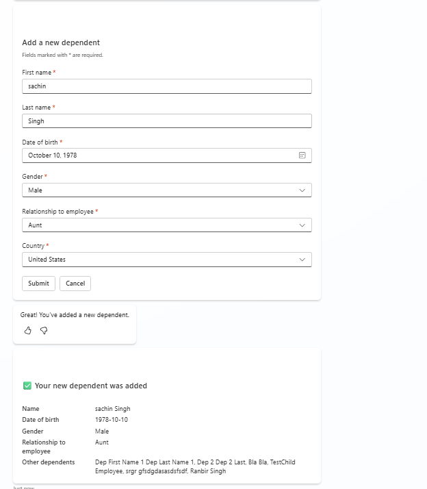

# Workday Employee Add Dependents

## Overview

This topic enables employees to view their existing dependents and add new dependents to their Workday profile through a conversational interface. Dependents include spouses, domestic partners, children, and other family members who may be covered under employee benefits.

## Features

- View existing dependents with their relationship and date of birth
- Add new dependents (spouse, child, domestic partner, etc.)
- Dynamic relationship type dropdown populated from Workday reference data
- Result summary after submission; the form's Submit action sends the request without a separate confirmation card
- Form validation for required fields

## Snapshots



## Trigger Phrases

- "Add a dependent"
- "I want to add my child as a dependent"
- "Add my spouse to my benefits"
- "Register a new dependent"
- "I need to add a family member"
- "Show my dependents"

## Files

| File | Description |
|------|-------------|
| `topic.yaml` | Copilot Studio topic definition with conversation flow |
| `msdyn_HRWorkdayHCMEmployeeGetDependents.xml` | XML template for fetching existing dependents |
| `msdyn_HRWorkdayHCMEmployeeAddDependent.xml` | XML template for adding a new dependent |

## Setup

Follow the [CEA prerequisites](../#before-you-start), then [register both template configurations](../#register-the-template-configurations). Use `msdyn_HRWorkdayHCMEmployeeGetDependents` and `msdyn_HRWorkdayHCMEmployeeAddDependent` as the records' **Unique name** values, with the corresponding complete XML in **Value**.

Review the country/gender choices in `collectDependentCard` and replace `<TENANT_NAME>` in `set_workday_url`. Then [add this scenario](../#add-a-scenario) by pasting the entire `topic.yaml` into a blank topic's code editor, resolving the CEA system-topic references, saving, and enabling it.

Keep `msdyn_copilotforemployeeselfservicehr.topic.WorkdaySystemGetCommonExecution` and `msdyn_copilotforemployeeselfservicehr.topic.GetReferenceData` configured. The reference-data call uses `Related_Person_Relationship_ID` to populate `Global.RelatedPersonRelationshipLookupTable`; the request uses the authenticated `Global.ESS_UserContext_Employee_Id`.

## Workday APIs Used

| API | Purpose |
|-----|---------|
| `Human_Resources v42.0` | Fetch existing dependents |
| `Benefits_Administration v45.1` | Add new dependent |

## Flow Overview

```
┌─────────────────────────────────────────────────────────────┐
│                    User Triggers Topic                       │
└─────────────────────────────────────────────────────────────┘
                              │
                              ▼
┌─────────────────────────────────────────────────────────────┐
│        Fetch Reference Data (Relationship Types)             │
└─────────────────────────────────────────────────────────────┘
                              │
                              ▼
┌─────────────────────────────────────────────────────────────┐
│              Fetch Existing Dependents                       │
└─────────────────────────────────────────────────────────────┘
                              │
                              ▼
┌─────────────────────────────────────────────────────────────┐
│     Display Existing Dependents (or "No dependents")         │
└─────────────────────────────────────────────────────────────┘
                              │
                              ▼
┌─────────────────────────────────────────────────────────────┐
│          Show Add Dependent Form (Adaptive Card)             │
└─────────────────────────────────────────────────────────────┘
                              │
                              ▼
┌─────────────────────────────────────────────────────────────┐
│              Submit to Workday                               │
└─────────────────────────────────────────────────────────────┘
                              │
                              ▼
┌─────────────────────────────────────────────────────────────┐
│           Show Success/Error Message                         │
└─────────────────────────────────────────────────────────────┘
```

## Configurations

Environment makers need to configure the following in the topic:

| Configuration | Description | Location in Topic |
|---------------|-------------|-------------------|
| **Gender Options** | Configure available gender options (Male, Female, Not_Declared) | Adaptive card dropdown |
| **Country Codes** | Define available country codes (USA, CAN, GBR, etc.) | Adaptive card dropdown |
| **Workday Icon** | Update the icon URL to match your organization's branding | `set_workday_icon_url` |
| **Workday URL** | Set the user-facing Workday tenant link; this does not configure connector authentication | `set_workday_url` |

## Dependencies

- **msdyn_HRWorkdayHCMEmployeeGetDependents template**: Required for fetching existing dependents
- **Employee Context**: Worker ID must be available in the conversation context

## Test and troubleshoot

Start a new test conversation. Check existing dependents and an employee with none, required-field validation, relationship labels, and **Cancel** without submitting. Use approved test data for **Submit**, which calls Workday immediately, then verify the new dependent in Workday. The write XML sets `Auto_Complete` to `true`; review that setting with your Workday business-process owner before rollout.

If existing dependents load but adding fails, inspect the write call's `addIsSuccess`/`addErrorResponse`, its separate configuration record, and Workday permissions. For missing relationship choices, check the reference-data dependency. Use the [shared CEA troubleshooting checks](../#troubleshooting) before publishing.
