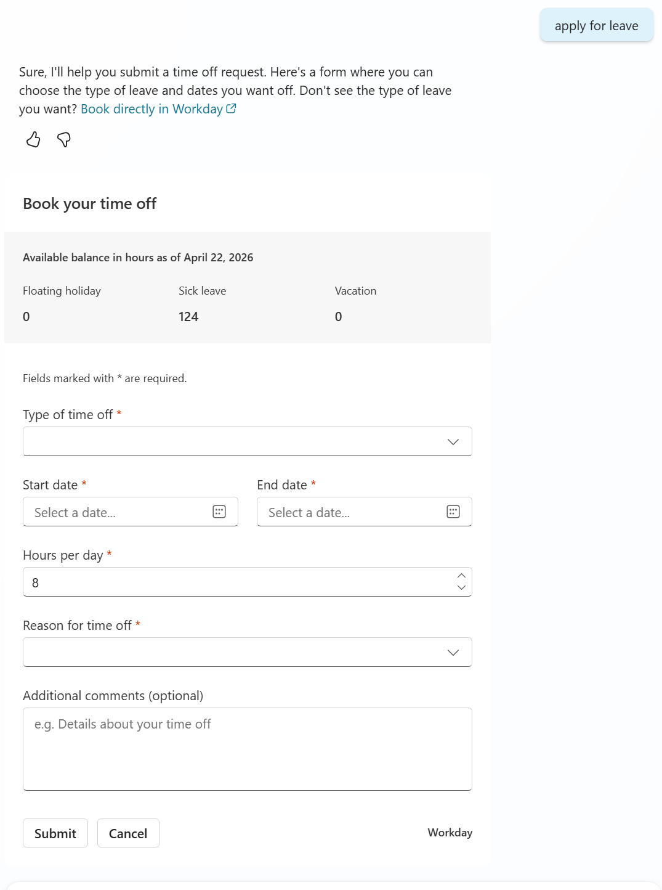
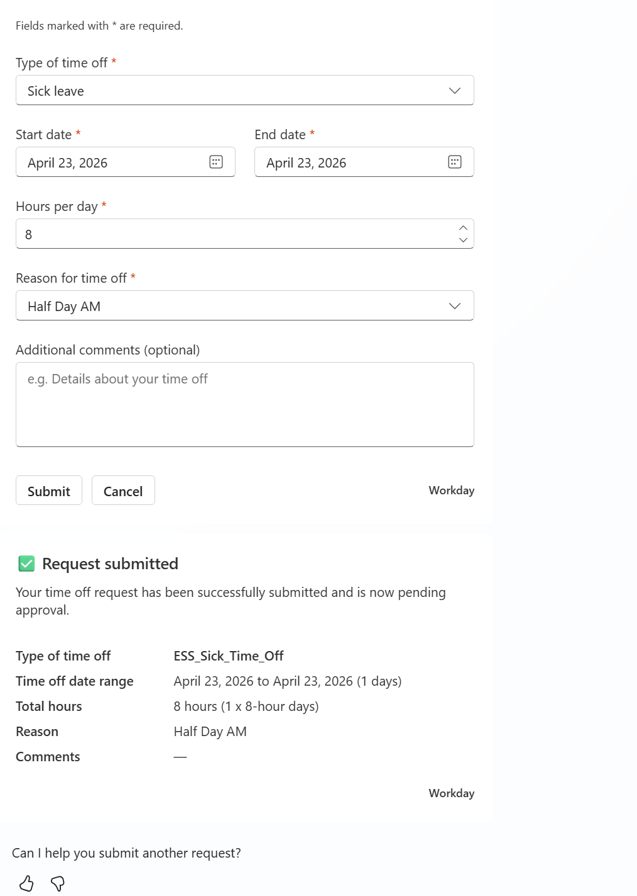

# Workday Employee Request Time Off

This topic lets employees submit single-day or multi-day time off requests to Workday directly from a Copilot Studio agent.

When an employee triggers this topic, the agent:

1. Fetches current leave balances from Workday
2. Shows an Adaptive Card form with leave type, dates, hours, and reason
3. Submits the request to the Workday `Enter_Time_Off` API
4. Displays a confirmation card or a friendly error with retry options

**Example trigger phrases:** "Request time off" · "Request vacation from January 5th to January 10th" · "Submit sick leave for next week"




{: .important }
> This topic ships with sample values from a reference Workday tenant. Every Workday tenant is configured differently — you must replace the Plan IDs, Reason IDs, leave types, and tenant URL with values from your own Workday setup before importing. See [Configure the topic](#configure-the-topic) for details.

## Prerequisites

Before you start, make sure you have:

- An editable ESS **Custom Engine Agent** with the ESS HR Workday integration and required CEA system topics configured; see the [shared CEA prerequisites](../#before-you-start)
- A Workday tenant with the **Absence_Management** module enabled
- A Workday connector configured with **User**-level authentication in your Power Platform environment
- The global variable **`Global.ESS_UserContext_Employee_Id`** populated at session start with the logged-in employee's Workday Employee ID
- The **`msdyn_HRWorkdayHCMEmployeeGetVacationBalance`** template already imported (from the [EmployeeGetVacationBalance](../EmployeeGetVacationBalance/) folder)
- Your organization's Workday Absence Plan IDs, Time Off Type IDs, and Reason IDs

## What's in this folder

| File | Description | Do you need to edit it? |
|------|-------------|------------------------|
| `topic.yaml` | Conversation flow, Adaptive Card form, configuration tables, error handling | Yes — update tenant URL, Plan IDs, Reason IDs |
| `msdyn_HRWorkdayAbsenceEnterTimeOff_MultiDay.xml` | SOAP template for the Workday `Enter_Time_Off` API | Usually no |
| `requestTimeOffAdapativeCard.png` | Screenshot of the Adaptive Card form | No |
| `requestTimeOffSubmitted.png` | Screenshot of the confirmation card | No |
| `README.md` | This file | No |

## Import the templates

Before configuring the topic, [register both ESS Template Configuration records](../#register-the-template-configurations) in the agent's environment:

| Unique name / topic `scenarioName` | Complete XML to paste in Value |
|---|---|
| `msdyn_HRWorkdayAbsenceEnterTimeOff_MultiDay` | [Time-off request](./msdyn_HRWorkdayAbsenceEnterTimeOff_MultiDay.xml) |
| `msdyn_HRWorkdayHCMEmployeeGetVacationBalance` | [Vacation balance](../EmployeeGetVacationBalance/msdyn_HRWorkdayHCMEmployeeGetVacationBalance.xml) |

You need the balance configuration even if you do not create the vacation-balance topic. Preserve the request XML's inner scenario name `EmployeeEnterTimeOff`; the record's **Unique name** is the lookup key above, not that inner name.

## Configure the topic

Open `topic.yaml` and update the following values to match your Workday tenant. All sample values shown below come from a reference tenant and **must** be replaced.

### Step 1: Set your Workday tenant URL

Find the `set_workday_url` node and replace `<TENANT_NAME>` with your tenant name:

```yaml
# Before
value: https://impl.workday.com/<TENANT_NAME>/home.htmld

# After — replace contoso_corp with your tenant
value: https://impl.workday.com/contoso_corp/home.htmld
```

Your Workday URL typically follows the pattern `https://<host>.workday.com/<tenant_name>/home.htmld`. Check your browser address bar when logged into Workday.

### Step 2: Update Plan IDs

Find the `set_plan_config` node. Replace each `PlanID` with the corresponding ID from your Workday tenant:

```
=Table(
  {PlanID: "ABSENCE_PLAN-6-139", DisplayName: "Floating holiday"},
  {PlanID: "ABSENCE_PLAN-6-159", DisplayName: "Sick leave"},
  {PlanID: "ABSENCE_PLAN-6-158", DisplayName: "Vacation"}
)
```

Obtain the Absence Plan IDs from your Workday administrator. Only plans listed here **and** returned by the Workday API will appear in the balance header.

### Step 3: Update Reason IDs

Find the `set_time_off_reason_config` node. Replace each `ReasonID` and `TimeOffTypeID` with your tenant's values:

| ReasonKey | TimeOffTypeID | ReasonID ← replace this |
|-----------|---------------|------------------------|
| `full_day` | `ESS_Vacation_Hours` | `Full Day_Vac` |
| `half_day_am` | `ESS_Vacation_Hours` | `Half Day_AM_Vac` |
| `half_day_pm` | `ESS_Vacation_Hours` | `Half Day_PM_Vac` |
| `full_day` | `ESS_Floating_Holiday_Hours` | `full_day_floating` |
| `half_day_am` | `ESS_Floating_Holiday_Hours` | `half_day_am_floating` |
| `half_day_pm` | `ESS_Floating_Holiday_Hours` | `half_day_pm_floating` |
| `full_day` | `ESS_Comp_Off` | `Full day-COI` |
| `half_day_am` | `ESS_Comp_Off` | `Half day AM-COI` |
| `half_day_pm` | `ESS_Comp_Off` | `Half day PM-COI` |
| `full_day` | `ESS_Sick_Time_Off` | `Full day_Sick_IN` |
| `half_day_am` | `ESS_Sick_Time_Off` | `Half day AM_Sick_IN` |
| `half_day_pm` | `ESS_Sick_Time_Off` | `Half day PM_Sick_IN` |

Don't rename the `ReasonKey` values — they're bound to the Adaptive Card "Reason for time off" dropdown.

### Step 4 (optional): Update leave-type choices

If your organization uses different leave types than Vacation, Floating holiday, Sick leave, and Comp off, update two places:

**The Adaptive Card dropdown** — in the `collect_time_off` node, edit the `choices` array. For example, to add Bereavement:

```json
{ "title": "Bereavement", "value": "ESS_Bereavement" }
```

**The keyword mapping** — in the `set_leave_type_config` node, add a row so the agent can pre-select the type from the user's utterance:

| Keywords (comma-separated) | LeaveTypeValue |
|---------------------------|----------------|
| `vacation,annual,pto,holiday pay` | `ESS_Vacation_Hours` |
| `floating,floater,float day` | `ESS_Floating_Holiday_Hours` |
| `sick,illness,medical,unwell,not feeling well` | `ESS_Sick_Time_Off` |

If you add a new leave type, also add matching rows to `TimeOffReasonConfig` (one per ReasonKey) and a friendly label to the success card's `Switch(Topic.timeOffType, ...)` expression. Keep the dropdown values, `LeaveTypeValue`, and `TimeOffTypeID` aligned; the supplied CEA sample already aligns the `ESS_`-prefixed values shown above.

### Step 5 (optional): Update the Workday icon

Find the `set_workday_icon_url` node and replace the 1×1 pixel placeholder with your organization's Workday icon URL.

## Import and test the topic

1. In Copilot Studio, select **Topics > Add a topic > From blank**.
2. Select **More > Open code editor** and replace the contents with the entire configured `topic.yaml`. Resolve the CEA common-execution reference, return to the canvas, save, and enable the topic; see [Add a scenario](../#add-a-scenario).
3. Start a **new test conversation** so employee context is initialized. Test cancellation and validation first, then submit only approved test requests:

| What to test | What to expect |
|-------------|---------------|
| Say "I want to request time off" | Balance header appears, then the Adaptive Card form |
| Say "Request vacation from September 15 to September 19" and submit | Success card with date range, type, hours, and reason |
| Submit with end date before start date | Error: "The end date can't be earlier than the start date" with retry |
| Select "I don't see my leave type listed" and submit | Redirect message with a link to Workday |
| Click **Cancel** | "Leave request was cancelled - nothing was submitted" |
| Submit dates that overlap an existing request | Friendly AI-rewritten error with retry |
| Include Vacation or Floating holiday in the prompt | The matching leave type is pre-selected; verify its friendly label on the result card |
| Request time off for another employee | The agent does not submit a request on their behalf |

Verify submitted requests in Workday, including the approval state. If balances show as empty but the form appears, check the balance configuration and whether `PlanConfig` IDs match plans returned for the employee. A visible form is not evidence that the balance lookup succeeded.

## XML template reference

The `msdyn_HRWorkdayAbsenceEnterTimeOff_MultiDay.xml` file is a SOAP template for the Workday `Enter_Time_Off_Request` operation. You usually don't need to edit it — placeholder tokens like `{Employee_ID}` and `{timeoff_Dates}` are filled at runtime.

Two settings you might want to change:

| Setting | Default | Change if… |
|---------|---------|------------|
| `<wd:Auto_Complete>` | `false` (does not auto-complete the business process) | Change only after review with your Workday business-process owner; approval routing is tenant-specific |
| `<version>` and `wd:version` | `v42.0` | Your tenant uses a different API version |

{: .important }
> If you change the API version, review **both** the `<version>` element and the `wd:version` attribute, then validate the request against your tenant. Saving XML does not prove API compatibility.

## What you can safely edit in the YAML

| What | Where in `topic.yaml` |
|------|----------------------|
| Workday tenant URL | `set_workday_url` node |
| Plan IDs | `set_plan_config` node |
| Reason and Time Off Type IDs | `set_time_off_reason_config` node |
| Leave-type keywords | `set_leave_type_config` node |
| Adaptive Card dropdown choices | `collect_time_off` node → `choices` array |
| Trigger phrases | `modelDescription` block |
| Workday icon | `set_workday_icon_url` node |
| Balance effective date | `set_as_of_effective_date` node (defaults to `Today()`) |

**Don't** change these — they'll break the topic:

- Node `id` values (`id: main`, `id: collect_time_off`, etc.) — referenced by `GotoAction` jumps
- `kind:` values — Copilot Studio node types
- `dialog:` contracts — must resolve to the installed CEA system topic; use the topic picker if its generated schema name differs, without changing its bindings
- `output: binding:` mappings — must match shared dialog outputs
- XML placeholder tokens (`{Employee_ID}`, `{timeoff_Dates}`, etc.) — filled at runtime
- The `EmployeeName` input contract — retained for orchestration; the request still uses the authenticated `Global.ESS_UserContext_Employee_Id`, and model instructions do not replace Workday authorization

## Dependencies

This topic depends on three external components:

- **Workday `Get_Time_Off_Plan_Balances`** — Absence_Management service, User-level auth. Uses the `msdyn_HRWorkdayHCMEmployeeGetVacationBalance` template from [EmployeeGetVacationBalance](../EmployeeGetVacationBalance/). Called at topic start to show balances.

- **Workday `Enter_Time_Off`** — Absence_Management v42.0, User-level auth. Uses the `msdyn_HRWorkdayAbsenceEnterTimeOff_MultiDay` template in this folder. Called after form submission.

- **`msdyn_copilotforemployeeselfservicehr.topic.WorkdaySystemGetCommonExecution` dialog** — the installed CEA system topic that executes XML templates against the Workday connector. Its inputs are `scenarioName` and `parameters`; preserve its `workdayResponse`, `isSuccess`, and `errorResponse` output bindings.

## Troubleshooting

**Balance header is empty or shows all zeros**
Your `PlanConfig` Plan IDs don't match your Workday tenant, or the balance template isn't imported. Verify the IDs and confirm `msdyn_HRWorkdayHCMEmployeeGetVacationBalance` is in your ESS Template Configuration.

**"Something went wrong" when submitting**
Inspect `isSuccess`/`errorResponse` and confirm `TimeOffReasonConfig` contains the selected type/reason pair with your tenant's IDs. Also review Workday business-process permissions and the submitted parameters with your administrator.

**Authentication error**
`Global.ESS_UserContext_Employee_Id` is empty or the Workday connector isn't configured. Verify both.

**Vacation isn't pre-selected when the user says "request vacation"**
Check your customized `LeaveTypeConfig` value against the Adaptive Card dropdown value. Both use `ESS_Vacation_Hours` in the supplied CEA YAML; do not remove its prefix when applying DA examples or older customizations.

**Success card shows a raw ID like `ESS_Vacation_Hours`**
The supplied success card maps the sample IDs to friendly names. If you added a leave type or changed an ID, update its `Switch()` expression to match the dropdown value.

## Tips

- Register the balance configuration **before testing** this topic — the balance lookup runs at topic start, and the form can appear even when balances were not retrieved.
- Update `PlanConfig`, `TimeOffReasonConfig`, **and** the Adaptive Card `choices` together — they're interconnected but maintained separately.
- Test with a real Workday employee ID that has leave balances.
- Keep `ReasonKey` values as `full_day`, `half_day_am`, `half_day_pm` — they're bound to the Adaptive Card dropdown.

## Handle repo updates

When this repo publishes a new version of the topic:

1. **Diff first.** Your customized tenant URL, Plan IDs, Reason IDs, and leave-type keywords will be overwritten if you re-import `topic.yaml`.
2. **Merge.** Preserve your config values when applying the updated YAML through the topic's code editor.
3. Back up and compare both XML configuration values before updating them. Preserve your customizations and use [Handle repo updates](../#handle-repo-updates); replacing a shared configuration can affect other topics.

## Known limitations

- **The date range includes every calendar day.** The loop increments by one day through the end date; it does not exclude weekends or holidays. Validate this against your Workday absence policies before rollout.
- **Submit sends the request immediately.** The confirmation card is a result after submission, not a separate approval step. Test **Cancel** before submitting and verify your tenant's approval routing in Workday.
- **Free-text comments are inserted into a JSON parameter string.** Validate quotes and line breaks with approved test text before enabling the scenario for employees.
