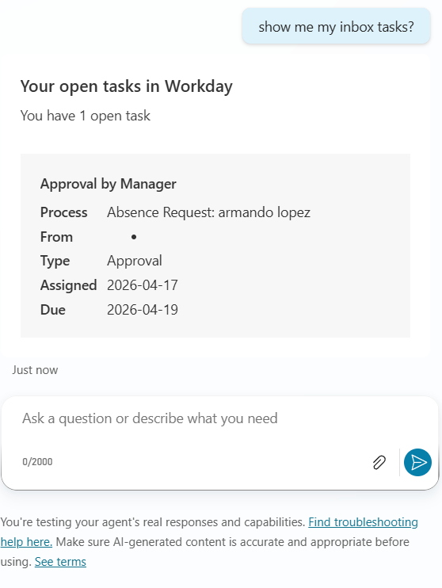
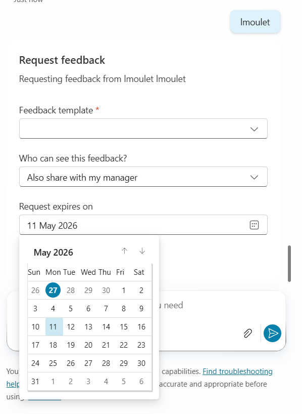
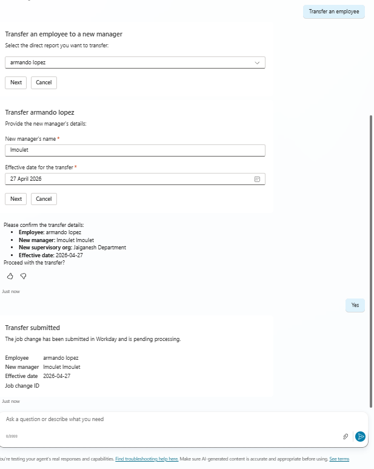
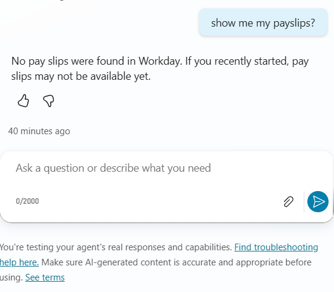

# Workday Extended Topics - Custom Engine Agent (CEA)

Extend your existing Employee Self-Service (ESS) **Custom Engine Agent (CEA)** with four REST-based Workday topics. Employees can view their inbox tasks and pay slips or request feedback about themselves; managers can submit a direct report's transfer to a different manager. Add only the scenarios your organization needs.

These samples extend an installed Workday integration; they do not install an agent, connections, system topics, or flows. Unlike the XML-based [employee](../Employee/) and [manager](../Manager/) samples, they call `WorkdaySystemGetRESTExecution` with an `operationName` and JSON `parameters`. Follow the REST setup below, not the XML template-registration steps. See the [Workday CEA overview](../) for all sample areas.

## Contents

| Topic file | Who uses it | Outcome | Sample prompt |
|---|---|---|---|
| [GetInboxTasks.yaml](./GetInboxTasks.yaml) | Employees | View open inbox tasks, with dates and process details | "What tasks do I have in Workday?" |
| [GetPaySlips.yaml](./GetPaySlips.yaml) | Employees | View pay-slip summaries with pay date, gross pay, net pay, and status | "Show my pay slips" |
| [RequestFeedback.yaml](./RequestFeedback.yaml) | Employees | Ask a coworker for feedback about the requesting employee | "Request feedback from a coworker" |
| [TransferEmployee.yaml](./TransferEmployee.yaml) | Managers | Submit a direct report's move to another supervisory organization | "Transfer an employee to a new manager" |

## Before you start

- Use an editable ESS Custom Engine Agent with its Workday integration installed and configured. Complete the [simplified Workday integration setup](https://learn.microsoft.com/en-us/copilot/employee-self-service/workday-simplified-setup), including authenticated connections, and have maker access to the agent's environment.
- Confirm `Global.ESS_UserContext_Employee_Id` is initialized from the signed-in employee's context. The supplied topics use `Employee_ID=` followed by this value for the requesting worker; do not replace it with a hard-coded test identity.
- Work with your Workday administrator to configure OAuth scopes, security-domain access, and business-process permissions for the operations you select. Payroll reads and feedback or transfer submissions need appropriate permissions; successful authentication alone is not sufficient.
- Use approved test identities and a non-production environment. Feedback requests create Workday records, and transfers initiate job changes. Verify access controls, cancellation, and submission behavior before making them available to users.
- Verify that your target channel supports the supplied Adaptive Card version `1.5`. Pay information and feedback are sensitive; do not put real records, tokens, or internal diagnostics in public issues.

### Required system topics and flow

1. In Copilot Studio, open **Topics** and confirm `WorkdaySystemGetRESTExecution` is installed and enabled. Open its flow action and follow the link to `WorkdayRESTExecution` in Power Automate.
2. Confirm that flow is **On**, its connection references are resolved, and its authenticated Workday connection is valid. Confirm it supports the selected operations below.
3. For transfers, also confirm `WorkdayManagerCheck` is installed and configured for the signed-in manager.

The existing setup uses the **EssITWorkdayHCM** or **EssHRWorkdayHCM** base integration. If a dependency is missing, install or update the appropriate integration through your supported solution-installation process before importing these topics. Pasting a topic does not create its dependencies.

| Scenario | REST `operationName` values |
|---|---|
| Inbox tasks | `GetWorkerInboxTasks` |
| Pay slips | `GetWorkerPaySlips` |
| Request feedback | `SearchWorkers`, `GetFeedbackTemplates`, `RequestFeedback` |
| Transfer employee | `GetWorkerDirectReports`, `SearchWorkers`, `GetSupervisoryOrganizationsManaged`, `TransferEmployee` |

Preserve the REST system topic's `operationName` and JSON `parameters` inputs and `workdayResponse`, `isSuccess`, and `errorResponse` outputs, including the scenario-specific topic variables bound to them. These samples do not supply XML files or `scenarioName` mappings to register in **Employee Self-Service Template Configuration**.

## Namespace check

All four supplied files reference `msdyn_copilotforemployeeselfservice.topic.WorkdaySystemGetRESTExecution`. The transfer topic separately references `msdyn_copilotforemployeeselfservicehr.topic.WorkdayManagerCheck`. Do not assume both dependencies have the same namespace or that pasting YAML automatically changes these references.

Resolve each `dialog:` reference through the topic picker against the dependency actually installed in your agent. Its schema may use a shared, HR, or IT prefix. Preserve the existing input/output contract and check for unresolved references before publishing; do not perform a blanket namespace replacement.

## How to add a topic

Add each selected YAML file through the topic code editor:

1. Open your ESS agent in Copilot Studio.
2. Go to **Topics** and click **Add a topic** then **From blank**.
3. Give the topic a name (see the suggested names in the table below).
4. Click the **...** menu on the topic and select **Open code editor**.
5. Select all the existing content, paste in the contents of the `.yaml` file, and save.
6. Repeat for any other topics you want to add.
7. Review the configuration below, enable the topic, and resolve topic-checker errors.
8. Complete [Validate before publishing](#validate-before-publishing). Publish only after review, then start a fresh conversation in the target channel to recheck routing, cards, and access scope.

Suggested topic names to use in step 3:

| File | Suggested topic name |
| --- | --- |
| [GetInboxTasks.yaml](./GetInboxTasks.yaml) | Get Employee Inbox Tasks |
| [GetPaySlips.yaml](./GetPaySlips.yaml) | Get Pay Slips |
| [RequestFeedback.yaml](./RequestFeedback.yaml) | Request Feedback on Worker |
| [TransferEmployee.yaml](./TransferEmployee.yaml) | Transfer Employee |

## Configuration

All topics require the installed dependencies, initialized employee context, and permissions above. Review these additional settings before testing.

### Transfer reason and destination

[TransferEmployee.yaml](./TransferEmployee.yaml) has a tenant-specific setting near the top of the file:

```yaml
- kind: SetVariable
  id: set_reason_id
  variable: Topic.TransferReasonId
  value: ""
```

If your tenant requires a job change reason, set `value` to the approved transfer reason ID from Workday's **Maintain Job Change Reasons**. If it is not required, leave `""`; the topic omits `jobChangeReasonId` from the request. Do not copy another tenant's reason ID.

The topic searches for the destination manager by **name**, lets you choose between matching workers, and retrieves their supervisory organizations. It selects the **first returned organization** without an organization picker; do not assume that is the intended destination when a manager owns several organizations. Review the organization shown in the final confirmation. The request sets `moveManagersTeam` to `false`.

### Feedback templates and visibility

[RequestFeedback.yaml](./RequestFeedback.yaml) retrieves templates for the requesting employee, not the coworker who will respond. Configure at least one applicable template and validate its availability through `GetFeedbackTemplates`.

The form offers "Share with me only" and "Also share with my manager." The supplied topic maps these choices to `feedbackConfidential: false` and `true`, respectively, and always sends `showFeedbackProviderName: true`. Validate the resulting visibility in Workday with your integration owner before relying on the card's labels as a privacy guarantee. The expiration date defaults to 14 days from today; confirm accepted dates and business rules in your tenant.

## Adjustable limits

The read topics expose request-size variables near the top of their files:

| Topic | Variable | Default request size | Offset |
| --- | --- | --- | --- |
| Inbox tasks | `Topic.MaxTasks` | 20 | 0 |
| Pay slips | `Topic.MaxSlips` | 10 | 0 |

For example, change the `Topic.MaxTasks` assignment from `value: =20` to `value: =10` to request fewer tasks. Validate supported limits with the installed REST flow and Workday API; the topics do not enforce a maximum of 100.

Other fixed first-page request sizes are 10 coworkers and 20 feedback templates for feedback, and 50 direct reports, five manager matches, and five supervisory organizations for transfers. None of the four topics implements a next-page loop. A desired person, template, or organization can therefore be missing from the first page. Narrow the search or address paging before promising complete results.

## Customize safely

Adjust trigger phrases, card labels, or explanatory text to match your organization. For example, add "Show my payroll summaries" to the pay-slip trigger queries without broadening the topic to other employees' pay information.

Preserve signed-in-user bindings, operation names, worker IDs returned by Workday, card input/output IDs, cancel actions, and the final transfer confirmation. Keep JSON escaping valid when editing `parameters`; test names containing quotes or other special characters. If response fields change, update parsing schemas and card expressions together.

The pay-slip topic shows numeric summaries, not PDF downloads or document attachments, even though its trigger list includes "Download my pay stub." The read cards describe results as "most recent," but the topics do not explicitly sort them; verify ordering with your installed REST operation.

## Validate before publishing

Start a new conversation for each test identity so employee context is refreshed. Use approved test data and compare outcomes with Workday, not only the agent's response.

| Check | What to verify |
|---|---|
| Dependencies and routing | All selected topics save without unresolved references, route from the listed prompts, and call the expected REST operations using the correct signed-in employee. |
| Inbox tasks | Compare titles, process, initiator, dates, total count, and displayed count with Workday. Test no tasks, missing optional fields, and more tasks than the requested limit. |
| Pay slips | Compare pay date, gross pay, net pay, status, ordering, and displayed count. Test no slips and missing fields. Confirm channel access and number/currency expectations; the card does not provide a download or a currency field. |
| Feedback selection | Test names supplied in the prompt and entered later, no matches, duplicate matches, unavailable templates, and template-retrieval failure. Confirm the employee is the subject and the selected coworker is the responder. |
| Feedback submission | Verify template, expiration, and actual Workday visibility for both sharing choices. Cancel before submission and confirm no request is created. For an approved submission, verify the resulting request in Workday. |
| Transfer selection | Test manager and non-manager access, no direct reports, ambiguous report names, multiple manager matches, no destination organization, and multiple organizations. Check the selected report and destination rather than trusting an autofilled name. |
| Transfer submission | Check reason requirements, effective-date rules, and the final confirmation. Cancel at each card and decline final confirmation; no job change should be created. Submit only an approved test transfer and verify its job-change record and subsequent business-process status. |
| Access boundary | Verify users cannot read another employee's tasks or pay, or transfer an employee outside their authorized scope. Workday permissions must enforce access; model instructions and a manager-check call alone are not proof of authorization. |
| Failure and retry | Test expired or unauthorized connections and operation failures using approved procedures. Inspect the corresponding `isSuccess` and `errorResponse` bindings. After an uncertain write outcome, check Workday before repeating; the topics do not supply an idempotency key. |
| Published channel | Check Adaptive Card rendering, required fields, cancellation, and sensitive-data handling in a fresh conversation after publishing. |

{: .important }
> "Transfer submitted" means the job change was accepted for processing, not that the transfer is complete or approved. Follow the returned job-change ID through your Workday business process. These validation steps are not a claim that runtime testing has been completed for every deployment.

## Troubleshooting

| Symptom | Check |
|---|---|
| A topic or global cannot be resolved | Check integration installation, employee-context initialization, and each actual dependency schema. Use the topic picker; do not invent globals or hard-code another employee's ID. |
| REST execution fails | Check the flow is On, connection references, OAuth scopes, Workday permissions, operation support, and the JSON parameters. Use approved flow diagnostics without exposing tokens or employee data. |
| A list is incomplete or a worker cannot be selected | Check first-page limits, search terms, employee scope, and Workday permissions. Do not infer that a record does not exist from an incomplete result set. |
| No feedback template is selectable | Check template applicability for the requesting employee and whether template retrieval succeeded. No templates and a failed lookup both produce an empty template list in this sample. |
| Feedback visibility differs from the card | Stop rollout of that scenario and validate the supplied flag mapping against Workday behavior with the integration owner. Relabeling the card does not change server-side visibility. |
| A transfer targets the wrong organization | Review the destination manager and first returned organization. Do not submit until the intended organization is confirmed. |
| A transfer was submitted but is not effective | Check the job-change ID, effective date, approvals, and processing state in Workday before retrying. |

## Handle updates

Back up topics before applying a newer sample. Review changes alongside your namespace bindings, tenant-specific reason IDs, card customizations, and REST integration version. Re-test selected scenarios and shared dependencies before publishing. Keep the prior topic version available for rollback; restoring a topic does not undo a feedback request or job change already submitted to Workday.

## Previews

**Get Inbox Tasks**



**Request Feedback**



**Transfer Employee**



**Get Pay Slips**

