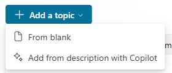
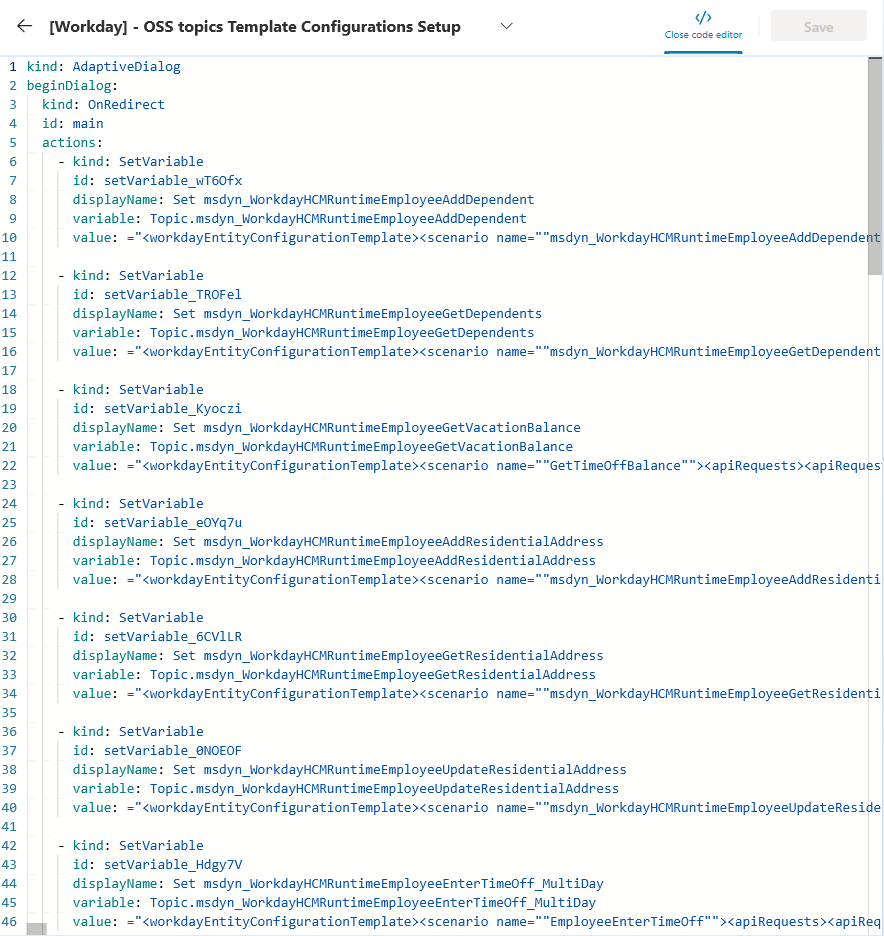
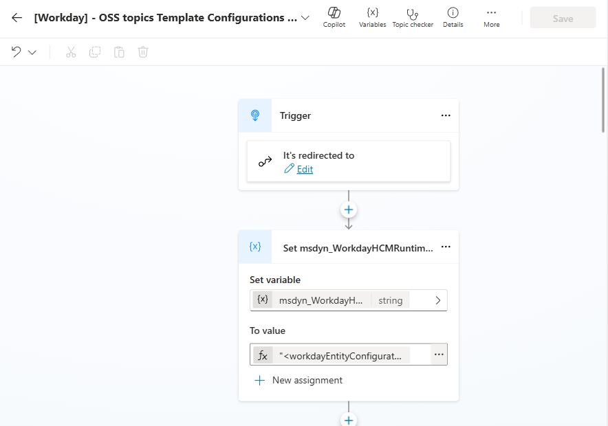
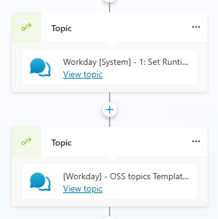

# ESS Workday Scenarios — DA GA

**Create one shared OSS setup topic, then add only the Workday scenarios you need.** Copy the supplied YAML into Copilot Studio; you do not create a separate template-configuration record for each XML file in Power Apps or Dataverse.

{: .important }
> Documentation draft for review. Confirm the prerequisites and scenario behavior in your environment before publishing. The screenshots illustrate authoring and wiring, not successful Workday execution.

This folder is for **DA GA**. The [DA Preview samples](../WorkdayDeclarativeAgentPreview/) retain their original per-scenario XML and configuration-record instructions.

| Step | DA Preview configuration model | DA GA model in this folder |
|---|---|---|
| Register request templates | Create the scenario's template-configuration records from individual XML files | Paste one complete shared setup topic containing all 22 OSS templates |
| Add a scenario | Create a topic from the scenario YAML | Still create a topic from each selected scenario YAML |

The simplification is configuration setup, not removal of Workday integration, permissions, tenant customization, or testing.

## Contents

| Folder | Description |
|---|---|
| [Shared configuration topic](./WorkdayOSSTemplateConfigurationSetup.yaml) | All 22 OSS Workday request templates and their lookup mappings |
| [Employee](./Employee/) | 11 employee self-service scenarios |
| [Manager](./Manager/) | 5 direct-report scenarios |

## Set up the shared configuration topic

### Before you start

Use an editable ESS HR DA GA agent with its Workday integration, authenticated connections, OOB configuration initializer, and required execution/reference-data/access-check topics already configured. Employee scenarios require initialized employee context, including `Global.ESS_UserContext_Employee_Id`. Work in a non-production agent while you configure and test the samples.

{: .warning }
> Manager scenarios also require a compatible HR user-context initializer that populates `Global.ESS_UserContext_Is_Manager` and `Global.ESS_UserContext_ManagerOrganizationId`. If these are absent or the topic checker reports an unrecognized identifier, resolve the HR-template prerequisite before using manager scenarios. Do not work around it by hard-coding a manager flag or organization ID.

### Create one setup topic

1. In your agent, select **Topics > Add a topic > From blank**.
2. Name it **WorkdayOSSTemplateConfigurationSetup**. The display name is your choice; the screenshot uses a different descriptive name for the same setup.
3. Select **More > Open code editor**. Replace the blank topic's contents with the **entire** [shared configuration topic](./WorkdayOSSTemplateConfigurationSetup.yaml). If viewing the file on GitHub, use its raw contents, not the surrounding page. Do not paste individual XML values or fragments.
4. Close the code editor to return to the canvas, save the topic, and ensure it is enabled.





The shared file already contains vacation balance and all emergency-contact add, update, and delete templates. There are no topic-specific configuration files or separate Dataverse configuration records to create for these GA samples.



### Run it from Conversation Start

Open **Topics > System > Conversation Start** and add a call to the new setup topic **after** the existing call to **Workday [System] - 1: Set Runtime Template Configurations**, and before any Workday scenario executes. Select your newly created topic through the topic picker rather than assuming its generated schema name matches the sample.

```text
Conversation Start
  -> existing OOB Workday configuration initialization
  -> WorkdayOSSTemplateConfigurationSetup
  -> selected Workday scenarios can use the global lookup
```



Alternatively, add the call inside **Workday [System] - 1: Set Runtime Template Configurations**, after its final assignment to `Global.ESS_WorkdayHCM_Template_Configurations`. Use **one wiring path, not both**. Run configuration initialization on every new conversation; do not put it behind a user-profile refresh cache.

{: .important }
> Ordering matters: initialize OOB configurations first, then OSS configurations. Running the OOB configuration initializer again afterwards can overwrite the OSS mappings.

The shared topic creates 22 template variables, compiles their `{ Key, Value }` mappings, and merges them into `Global.ESS_WorkdayHCM_Template_Configurations`. For a matching key, the OSS XML replaces the existing value; unrelated OOB mappings are retained. Re-running the shared topic does not add duplicate OSS keys. Test any existing OOB scenarios that share overridden keys as well as your selected OSS scenarios.

Loading all templates is intentional, even if you use only a subset of scenarios. This does **not** create or enable the unused scenario topics, call Workday, or submit employee changes.

{: .note }
> Contact Information also calls `msdyn_WorkdayHCMRuntimeEmployeeGetWorkAddress` and `msdyn_WorkdayHCMRuntimeEmployeeGetWorkContactInformation`. These two templates have no source XML in the OSS samples and remain dependencies on your existing OOB configuration.

## Add a scenario

Choose any combination of the 11 [employee scenarios](./Employee/) and 5 [manager scenarios](./Manager/). You do not have to install all 16.

1. Open the selected scenario folder and copy its complete `topic.yaml`.
2. Create another blank topic with **Topics > Add a topic > From blank**, open **More > Open code editor**, and replace its contents with that YAML.
3. Review tenant URLs, picklists, IDs, parameter bindings, and any scenario-specific instructions. Resolve child-topic references against the existing topics in your agent without changing their input/output contracts.
4. Save and enable the selected scenario. Repeat only for the other scenarios you want.

Keep the existing Workday execution, reference-data, access-check, and manager-check topics configured. Scenario topics pass a `scenarioName` to the existing runtime; the matching XML comes from the global lookup populated by the shared setup. You do not repeat configuration setup when adding another scenario.

### Check the setup before publishing

Start a **new test conversation** so Conversation Start runs again. Confirm that the topic checker has no unresolved references and that the expected OSS keys are available in `Global.ESS_WorkdayHCM_Template_Configurations` after both initializers run.

Try an employee read using the prompts below. For any selected write scenario, use approved test data and check confirmation, cancellation, and error behavior before submitting changes. For manager scenarios, verify an actual manager's organization and access, plus non-manager behavior; an organization ID alone is not proof of manager privileges.

Publish only after your normal review and validation. Start a fresh conversation in the target channel after publishing; a conversation that began before the update can retain old configuration values.

### Troubleshooting

| Symptom | Check |
|---|---|
| Scenario configuration is missing or blank | Confirm OOB initialization runs first, the OSS call is enabled and reached, and the lookup `Key` matches the scenario's `scenarioName`. Restart the conversation. |
| OSS values disappear later | Look for another OOB initializer running after OSS setup, or configuration setup incorrectly guarded by a user-context cache. |
| Manager organization/status is unrecognized or empty | Resolve the HR user-context prerequisite and refresh context. Do not invent a global value or bypass access checks. |
| A child-topic reference cannot be resolved | Use the existing topic picker and verify the required HR system topic and its bindings are present in your agent. |
| The topic saves but Workday fails or returns unexpected data | Review authentication, tenant-specific values, Workday permissions, API/template compatibility, and the scenario's error output. Saving YAML alone does not validate the integration. |

## Customize and update configurations

Make template changes in **WorkdayOSSTemplateConfigurationSetup**. Keep each lookup `Key` aligned with the scenario topic's `scenarioName` and its XML variable mapping, and preserve Power Fx quote escaping in XML string values. Do not rename placeholder tokens or assume that every inner XML scenario name must be identical to its lookup key.

For future OSS or ESS updates, export or back up your current setup topic before replacing it. Compare the previous sample version, your customized version, and the incoming version; merge the changes you need rather than overwriting customer customizations. Compare decoded XML values with a local XML comparison tool, or an approved online XML comparison tool for sanitized, non-sensitive XML only. Do not upload credentials, tenant details, employee data, or proprietary configuration to a public comparison service.

After merging, save and publish, start a new conversation, and check the scenarios you use. Pulling updates and resolving customization conflicts are maker-managed steps; this sample does not automatically update an agent.

## Scenarios

| Scenario | Description | Sample prompt(s) |
|---|---|---|
| `EmployeeAddDependents` | Lets employees add a new dependent (spouse, partner, child, parent) to their own Workday profile and benefits. | "Add a dependent"<br>"Add my spouse to my benefits"<br>"I had a baby — add them as a dependent" |
| `EmployeeGetVacationBalance` | Returns the requesting user's vacation balance information from Workday. Displays available time off that can be taken. | "What is my vacation balance?"<br>"How much time off can I take?"<br>"What is my workday vacation balance?" |
| `EmployeeUpdateResidentialAddress` | Lets employees view and update their own residential/home address in Workday. | "Update my home address"<br>"I moved — fix my address"<br>"Change my street and zip code" |
| `WorkdayEmployeeRequestTimeOff` | Allows employees to submit time off requests for themselves through Workday. Prompts for necessary details like dates and hours. | "Request 8 hours vacation on 2025-09-15"<br>"I want to request time off"<br>"Submit vacation request" |
| `WorkdayEmployeesviewtheirjobtaxonomy` | Responds to requests about the requesting user's job taxonomy (job title, job function, job profile). | "What is my job title?"<br>"What is my external title?" |
| `WorkdayGetContactInformation` | Returns the requesting user's contact information (work/home phones, emails, addresses). | "What is my Work Phone?"<br>"Show my Home Email" |
| `WorkdayGetEducation` | Returns the requesting user's education history (school, degree, field of study, years attended). | "Show my Education Details"<br>"What was my field of study?" |
| `WorkdayGetGovernmentIDs` | Returns government ID information associated with the requesting user's profile (ID types, issued/expiration dates, country). | "What are my Government Ids?" |
| `WorkdayGetUserProfile` | Returns the requesting user's personal profile from Workday: identity, contact, and organization information. | "Show my employee profile"<br>"What's my employee ID?"<br>"Who is my manager?" |
| `WorkdayGivePeerFeedback` | Lets employees send feedback about a coworker through Workday. | "Give feedback"<br>"Share feedback for a colleague"<br>"Submit peer feedback" |
| `WorkdayManageEmergencyContact` | Lets employees view, add, update, or remove their own emergency contacts in Workday. | "Manage my emergency contacts"<br>"Update my emergency contact"<br>"Who is my emergency contact?" |
| `WorkdayGetManagerReporteesTimeInPosition` | Returns how long each of the requesting manager's direct reports has been in their current position. | "How long has my team been in their roles?"<br>"What is [EmployeeName]'s time in position?" |
| `WorkdayManagersdirect-CompanyCode` | Returns company code and company name for employees who directly report to the requesting user (manager view). Output is produced as a nested markdown list. | "What are the company codes for my reports?" |
| `WorkdayManagersdirect-CostCenter` | Returns cost center details for direct reports of the requesting user. Output is produced as a nested markdown list. | "What is the cost center of my direct reports?" |
| `WorkdayManagersdirect-Jobtaxanomy` | Returns job taxonomy (job title, business title, job profile, job family) for the manager's direct reports. Output is produced as a nested markdown list. | "Show me my team's job title"<br>"What is the job title of [EmployeeName]?" |
| `WorkdayManagerServiceAnniversary` | Returns upcoming service anniversaries for a manager's direct reports. The topic returns a markdown table with Employee Name, Hire Date, Upcoming Service Anniversary Date, Upcoming Milestone. | "When are the service anniversaries of all my directs?"<br>"What is [EmployeeName]'s next service anniversary?" |