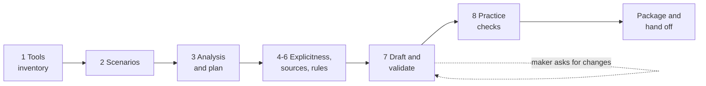

# ESS DA GA Skill Builder

Builds agent skills for ESS declarative agents (DA GA) in Microsoft 365 Copilot from the agent's own MCP tools, through a guided conversation with the maker. Run `/build-skill` in the ESS Maker Kit, or ask something like "Build a skill for opening HR cases".

> [!NOTE]
> This README explains how the builder works and how it was built. The agent follows [SKILL.md](SKILL.md). The builder runs inside the Maker Kit; it isn't uploaded to Copilot, so this README never ships with an agent.

Grounded in Microsoft 365 Copilot documentation, the Agent Skills specification and best-practice guides (agentskills.io), and applicable skill-authoring guidance from Anthropic and OpenAI. See [sources.md](references/sources.md) for source precedence and host scope.

## Contents

- [Quick start](#quick-start)
- [What it produces](#what-it-produces)
- [How a run works](#how-a-run-works)
- [Design principles](#design-principles)
- [Folder layout](#folder-layout)
- [Scripts](#scripts)
- [How it was built](#how-it-was-built)
- [Practices from external guides](#practices-from-external-guides)
- [Where we deliberately differ](#where-we-deliberately-differ)
- [Keeping it current](#keeping-it-current)
- [Tests](#tests)

## Quick start

1. Put each MCP server's tool list in `workspace/ess-da-ga-skill-builder-capabilities/mcp/<server-name>/tools.json`, optionally with the agent's plugin file as `plugin.json`; the `capabilities` array from `declarativeAgent.json` in `knowledge/knowledge.json`; and the agent's existing skills in `skills/`. [references/capabilities-folder.md](references/capabilities-folder.md) describes the accepted formats. You can also point the builder at your agent's app package and it copies what it needs.
2. Run `/build-skill` and describe, in your own words, what employees should be able to do.
3. Answer a few questions per round, then review the draft until it looks right.
4. Add the result to your agent: upload `workspace/skills/<skill-name>.zip` in Copilot Studio or Agent Builder, or add the folder with the Microsoft 365 Agents Toolkit.

You need Python 3.11 or later; the scripts use only the standard library. No setup is required, nothing leaves your machine, and your agent doesn't change until you add the skill.

## What it produces

| Output | Contents |
| --- | --- |
| `workspace/skills/<skill-name>/` | The finished skill: `SKILL.md` plus any `references/` and `assets/` |
| `workspace/skills/<skill-name>.zip` | The same skill packaged for upload, with `SKILL.md` at the root |
| `workspace/ess-da-ga-skill-builder/<plan-name>/iteration-<n>/` | The working folder: `inventory.json`, `plan.md`, drafts, `evals.json` and grading results |
| `plan.md` | Scenarios, the step-by-step capability map, scenario verdicts, the skill plan, every decision the maker made, domain facts with their sources, and rules the developer must also enforce in the tools |

## How a run works



| Round | What happens | Reads |
| --- | --- | --- |
| 1. Tools and knowledge | Finds the tool lists and knowledge sources, runs the inventory, and describes in plain language what the agent can show, create, change, comment on or search | [capabilities-folder.md](references/capabilities-folder.md) |
| 2. Scenarios | Captures job stories, example requests and acceptance criteria | [interview.md](references/interview.md) |
| 3. Analysis and plan | For each step of each scenario, judges from the tool descriptions whether a tool is purpose-built, a building block, partial or missing, and whether informational steps have a knowledge source; gives each scenario a verdict; recommends how to split or merge skills within the 8-skill limit, including an orchestration skill for mixed requests; flags conflicts with what the maker asked for | [limitations.md](references/limitations.md), [scenario-analysis.md](references/scenario-analysis.md) |
| 4. Explicitness | Exact steps for changes and flexible lookups, exact everywhere, or goals only; where system details live | [interview.md](references/interview.md) |
| 5. Sources | Grounds tables, fields, defaults and codes in ESS samples, template configurations or the maker's documents, citing each fact | `src/examples/ess-samples/`, `src/reference/ess-docs/` |
| 6. Rules | Confirmation style, acting on behalf of others, defaults | [interview.md](references/interview.md) |
| 7. Draft and validate | Drafts from the template, validates, shows the maker a plain-language summary, and loops on feedback with a new iteration folder each time | [authoring-rules.md](references/authoring-rules.md), [examples.md](references/examples.md) |
| 8. Practice checks | Writes trigger and behavior evals; optionally runs them with subagents against a baseline | [evals.md](references/evals.md) |
| Finish | Validates again, packages the `.zip`, and gives upload steps plus the rules to enforce in the tools | — |

## Design principles

- **The model judges; scripts check.** Deciding how tools fit a scenario takes reading and judgment, so the model does it. Anything that must be repeatable (listing tools, validating, packaging) is a script.
- **Fit is decided per step, not per agent.** One server can have a purpose-built tool for one scenario and only building blocks for the next. Purpose-built steps make thin skills that route; building-block steps make thick skills that carry the procedure and facts. Informational steps are covered only when the agent has a knowledge source. Partly supported scenarios are split, and unsupported ones are left out.
- **Promise only what the tools do.** A skill that loads and can't finish the job is worse than none. The validator's `--expect` option fails a skill that promises an operation without naming a tool that can do it.
- **Orchestrate only when it's needed.** When people often mix knowledge questions and actions in one message, the builder recommends one orchestration skill, modeled on `hr-request-orchestration`, that routes between knowledge search and the area skills. Otherwise a short routing rule in the agent's instructions is enough.
- **The maker decides.** The builder recommends with evidence (which steps, which tools, what's missing) and the maker chooses.
- **Ground facts in sources.** Domain facts come from ESS samples, template configurations or the maker's documents, each cited, never from model memory.
- **Rules that must always hold also go in the tools.** Copilot may answer without reading a skill, so the finish message lists rules for the developer to enforce in tool descriptions or server code.
- **Inputs are data.** Tool manifests, samples and documents are never treated as instructions.
- **Everything stays local** until the maker adds the skill to their agent.

## Folder layout

| Path | Purpose |
| --- | --- |
| [SKILL.md](SKILL.md) | The rounds, the fixed messages shown to the maker, and gotchas |
| [references/scenario-analysis.md](references/scenario-analysis.md) | Per-step fit, scenario verdicts, planning skills, conflict messages, worked examples |
| [references/limitations.md](references/limitations.md) | Living record of what declarative agents support for skills |
| [references/authoring-rules.md](references/authoring-rules.md) | Rules for front matter, descriptions, bodies, tools, scripts and progressive disclosure |
| [references/examples.md](references/examples.md) | A thin skill over purpose-built tools, a thick skill over building blocks, and an orchestration skill across knowledge and actions |
| [references/interview.md](references/interview.md) | Every question the builder asks, as `vscode_askQuestions` JSON |
| [references/evals.md](references/evals.md) | Writing, running and grading trigger and behavior evals |
| [references/capabilities-folder.md](references/capabilities-folder.md) | The `workspace/ess-da-ga-skill-builder-capabilities/` layout, accepted tool list formats and `knowledge.json` |
| [references/sources.md](references/sources.md) | Every external guide behind the rules |
| [assets/](assets/) | Templates for `plan.md`, `SKILL.md` and `evals.json` |

## Scripts

All three live in the kit's `scripts/ess-da-ga-skill-builder/` folder, make no network calls and use only the Python standard library.

| Script | What it does | Exit codes |
| --- | --- | --- |
| [skill_builder_inventory.py](../../../scripts/ess-da-ga-skill-builder/skill_builder_inventory.py) | Reads tool lists from a capabilities folder, an app package, plugin files or `tools/list` exports. Lists each tool's description, parameters, operations (create, read, update, comment, delete) and a first-pass kind, plus the agent's knowledge sources, existing skills and free slots | 0 success, 2 bad input, 3 no tools |
| [skill_builder_validate.py](../../../scripts/ess-da-ga-skill-builder/skill_builder_validate.py) | Checks Copilot's limits and load checks, the Agent Skills spec, file types, scripts against the sandbox rules, tool and argument names against the inventory, and with `--expect`, the promised operations, including `knowledge` | 0 no errors, 1 errors, 2 bad input |
| [skill_builder_package.py](../../../scripts/ess-da-ga-skill-builder/skill_builder_package.py) | Validates again and writes the upload `.zip` with `SKILL.md` at its root | 0 packaged, 1 errors, 2 bad input |

```powershell
python scripts/ess-da-ga-skill-builder/skill_builder_inventory.py --capabilities workspace/ess-da-ga-skill-builder-capabilities --out workspace/ess-da-ga-skill-builder/hr-cases/iteration-1/inventory.json
python scripts/ess-da-ga-skill-builder/skill_builder_validate.py workspace/ess-da-ga-skill-builder/hr-cases/iteration-1/hr-case-create --inventory workspace/ess-da-ga-skill-builder/hr-cases/iteration-1/inventory.json --expect create,read
python scripts/ess-da-ga-skill-builder/skill_builder_package.py workspace/skills/hr-case-create --inventory workspace/ess-da-ga-skill-builder/hr-cases/iteration-1/inventory.json --expect create,read
```

## How it was built

1. **Research.** Microsoft 365 Copilot documentation sets the target-platform requirements. The Agent Skills specification and best-practice guides supply the format and portable conventions; Anthropic's and OpenAI's authoring guides and `skill-creator` skills supply techniques adapted to Copilot. [Practices from external guides](#practices-from-external-guides) maps each practice to where it's applied.
2. **Documented behavior and separate ESS testing findings.** Microsoft documents that the model initially sees only each skill's name and description (RT-01). Separately, ESS tests found that the model often answered without reading the rest, "Read this skill before …" did not increase loading, and instructions in tool results caused content-filter refusals. Those testing findings are **Observed**, not platform guarantees (RT-02, RT-04 and RT-05 in [limitations.md](references/limitations.md)). They motivate enforcing must-hold rules in tool descriptions or server code as well.
3. **Trial.** A first version of the builder ran against an ESS agent with generic ServiceNow record tools. An agent with a clean context rebuilt an existing HR case creation skill without seeing the original, and its six points of feedback went into the builder. In a blind A/B comparison of offline planning runs, both skills passed all 16 checks, and the grader preferred the generated one: it used the case form and planned 10 tool calls instead of 19.
4. **Port into the Maker Kit.** The builder became interactive: at most three questions per round, each with a recommended option, with every decision recorded in `plan.md`. Tools now come from a capabilities folder. Fit is decided per step instead of labeling the whole agent. Promised operations are checked, scripts are checked against the sandbox rules, and the output is packaged for upload.
5. **Living references.** [limitations.md](references/limitations.md) records the platform's limits with their status and source, and [sources.md](references/sources.md) lists every external guide. A test fails if the limits in the record and the scripts disagree.
6. **Verification.** Tests cover the inventory, the validator, the packager, the limitations record, the source list, the question bank and the command routing. Existing ESS agent skills validate with no errors.

## Practices from external guides

Each table maps a practice from an external guide to where the builder applies it. Microsoft documentation comes first for target-platform requirements, followed by the Agent Skills format and portable conventions, then applicable Anthropic and OpenAI techniques. Guidance about another host does not establish Copilot support.

### Microsoft 365 Copilot and Copilot Studio

Sources: [Skills in declarative agents][ms-skills], [Add skills in Agent Builder][ms-builder], [Add skills with the Agents Toolkit][ms-toolkit], [Write effective instructions][ms-instructions], [MCP apps][ms-mcp-apps], [MCP apps UX guidelines][ms-mcp-ux], [Plugin manifest schema 2.4][ms-plugin], [Add and manage an uploaded skill][studio-upload], [Create a skill][studio-create].

| Practice | Where we applied it |
| --- | --- |
| 8 skills per agent, `SKILL.md` under 20,000 characters, directory depth 3, 350 files, 50 MB packages and 25 MB files, a 10 MB app package for the Agents Toolkit, supported file types | [limitations.md](references/limitations.md), the validator and the packager, kept in sync by a test |
| Scripts run with no network access, can't install packages and can't call MCP servers | The validator rejects network imports and commands and package installs; generated skills have no scripts by default |
| Upload a `.zip` with `SKILL.md` at its root; enable `TEAMSFX_AGENT_SKILLS` and use manifest version 1.9 for the Agents Toolkit | The packager and the finish message |
| `SKILL.md` is UTF-8 without a byte-order mark, with valid YAML front matter | Validator |
| Functions marked `isNonConsequential` run without asking the user | The validator notes that the skill's confirmation or form is then the only safeguard |
| A widget is the answer and a form collects its own input | Gotchas in [SKILL.md](SKILL.md) and [authoring-rules.md](references/authoring-rules.md) |

### Agent Skills specification

Source: [Specification][spec].

| Practice | Where we applied it |
| --- | --- |
| `name` uses lowercase letters, digits and hyphens, up to 64 characters, and matches the folder | This skill is `ess-da-ga-skill-builder`; the validator enforces the rule |
| `description` is required, up to 1,024 characters, with no XML tags | Validator |
| `SKILL.md` stays under 500 lines and about 5,000 tokens; detail goes in `references/` and `assets/` | This `SKILL.md` is about 13 KB; each reference is read only at the round that needs it |
| References are one level deep from `SKILL.md` | The validator warns about reference-to-reference links |

### Best practices for skill creators

Source: [Best practices for skill creators][bp].

| Practice | Where we applied it |
| --- | --- |
| Start from real expertise, not general model knowledge | Round 5 grounds every fact in ESS samples, template configurations or the maker's documents, and never states vendor behavior from memory |
| Add only what the agent lacks | Skills never restate a tool's description; purpose-built tools get thin skills |
| Match how specific instructions are to how fragile each step is | Round 4: exact for changes, flexible for lookups |
| Give one default approach, not a menu | [authoring-rules.md](references/authoring-rules.md) and the skill template |
| Include gotchas, output templates and validation loops | The skill template has Gotchas and Don'ts sections; Round 7 drafts, validates and fixes |
| Scope each skill as a coherent unit | Round 3 split and merge rules |

### Optimizing skill descriptions

Source: [Optimizing skill descriptions][desc].

| Practice | Where we applied it |
| --- | --- |
| Describe user intent in third person, add "Use when …", lean slightly pushy, include phrasings that don't name the area | [authoring-rules.md](references/authoring-rules.md); the validator warns when "Use when" is missing |
| Test triggering with near misses, a train and validation split, and several runs per query | [evals.md](references/evals.md) and `assets/evals-template.json` |

### Evaluating skill output quality

Source: [Evaluating skill output quality][evals].

| Practice | Where we applied it |
| --- | --- |
| Compare runs with and without the skill, each in a fresh context | Round 8 through `runSubagent`; the A/B comparison during the trial |
| Write checkable assertions, grade with quoted evidence, and fix assertions that never discriminate | [evals.md](references/evals.md), with `grading.json` and `benchmark.json` |
| Iterate, generalize fixes and remove what isn't needed | The review loop, with a new `iteration-<n>` folder per change |

### Using scripts in skills

Source: [Using scripts in skills][scripts].

| Practice | Where we applied it |
| --- | --- |
| Scripts are non-interactive, document themselves with `--help`, print clear errors and structured output, and use distinct exit codes | All three `skill_builder_*.py` scripts |
| Use scripts for repeatable, deterministic work | Inventory, validation and packaging are scripts; judgment stays with the model. Generated skills have no scripts by default |

### Anthropic skill authoring best practices

Sources: [Skill authoring best practices][anthropic-bp], [Agent Skills overview][anthropic-overview].

| Practice | Where we applied it |
| --- | --- |
| Be concise; the context window is shared | Authoring rule: every sentence must change what the agent does |
| Set degrees of freedom (high, medium, low) to match the task | Round 4 explicitness options |
| Use fully qualified MCP tool names | The validator checks every tool and argument name against the inventory, including prefixed names |
| Avoid time-sensitive wording; use consistent terms and forward slashes | [authoring-rules.md](references/authoring-rules.md); the validator flags time-sensitive wording |
| Start long reference files with a contents list | The validator warns about references over 100 lines without one |
| Develop with one instance and test with a fresh one | The clean-context rebuild and blind grading during the trial; subagent checks in Round 8 |

### Skill-creator skills from Anthropic and OpenAI

Sources: [Anthropic skill-creator][anthropic-creator], [OpenAI skill-creator][openai-creator].

| Practice | Where we applied it |
| --- | --- |
| Interview the author to capture intent, with concrete examples | Rounds 1 to 6 and the [interview.md](references/interview.md) question bank |
| Draft, test, grade and iterate in a workspace | `workspace/ess-da-ga-skill-builder/<plan-name>/iteration-<n>/` |
| Explain why instead of piling on MUSTs | Authoring rule: models follow reasons more reliably than bare MUSTs |
| Validate, then package | `skill_builder_package.py` |
| Keep extra files out of the skill | Plans, evals and notes stay outside the skill folder, because everything inside it ships with the agent |

### OpenAI skills guides

Sources: [Build skills][openai-build], [Skills and plugins][openai-plugins], [Using skills][openai-academy], [Skills (OpenAI API)][openai-api].

| Practice | Where we applied it |
| --- | --- |
| Start from a repeatable workflow | Round 2 job stories and example requests |
| Load detail progressively; package as a folder or `.zip` | The builder's own structure; the packager writes the `.zip` |

### Model Context Protocol

Sources: [Tools][mcp-tools], [MCP Apps][mcp-apps].

| Practice | Where we applied it |
| --- | --- |
| `readOnlyHint` and `destructiveHint` annotations describe a tool's effect | The inventory derives each tool's access from them |
| App-only tools are called by the widget, not the model | The inventory marks them `widget-action`; the validator warns if a skill names one |

## Where we deliberately differ

- **Skill names describe the user's intent** (`hr-case-create`) rather than following Anthropic's suggested gerund form.
- **No `compatibility` or `allowed-tools` fields**, because Copilot doesn't use them.
- **Trigger checks are offline subagent runs**, not an automated description-optimization loop.
- **Additional safeguards come from ESS testing**, such as avoiding instructions in tool results. They supplement documented Microsoft requirements, are recorded as **Observed** in [limitations.md](references/limitations.md), and are not platform guarantees.

## Keeping it current

- **Limits:** [limitations.md](references/limitations.md) is the living record. Follow its "How to update this record" steps. When a script enforces a limit, change the script's constant in the same change; the tests fail if the two disagree.
- **Guides:** add new external guides to [sources.md](references/sources.md), and add the practices they introduce to this README. Keep Microsoft documentation first, preserve host scope, and keep testing observations distinct from documented requirements.
- **Questions:** add or change maker questions in [interview.md](references/interview.md); each must stay valid `vscode_askQuestions` JSON.

## Tests

```powershell
python -m pytest tests/scripts/test_skill_builder.py
```

Fixtures live in [tests/fixtures/ess-da-ga-skill-builder/](../../../../../tests/fixtures/ess-da-ga-skill-builder/).

[ms-skills]: https://learn.microsoft.com/microsoft-365/copilot/extensibility/declarative-agent-skills
[ms-builder]: https://learn.microsoft.com/microsoft-365/copilot/extensibility/agent-builder-add-skills
[ms-toolkit]: https://learn.microsoft.com/microsoft-365/copilot/extensibility/build-declarative-agents-add-custom-skills
[ms-instructions]: https://learn.microsoft.com/microsoft-365/copilot/extensibility/declarative-agent-instructions
[ms-mcp-apps]: https://learn.microsoft.com/microsoft-365/copilot/extensibility/plugin-mcp-apps
[ms-mcp-ux]: https://learn.microsoft.com/microsoft-365/copilot/extensibility/plugin-mcp-apps-ui-guidelines
[ms-plugin]: https://learn.microsoft.com/microsoft-365/copilot/extensibility/plugin-manifest-2.4
[studio-upload]: https://learn.microsoft.com/microsoft-copilot-studio/agents-experience/skills-add-existing
[studio-create]: https://learn.microsoft.com/microsoft-copilot-studio/agents-experience/skills-create
[spec]: https://agentskills.io/specification
[bp]: https://agentskills.io/skill-creation/best-practices
[desc]: https://agentskills.io/skill-creation/optimizing-descriptions
[evals]: https://agentskills.io/skill-creation/evaluating-skills
[scripts]: https://agentskills.io/skill-creation/using-scripts
[anthropic-bp]: https://platform.claude.com/docs/en/agents-and-tools/agent-skills/best-practices
[anthropic-overview]: https://platform.claude.com/docs/en/agents-and-tools/agent-skills/overview
[anthropic-creator]: https://github.com/anthropics/skills/tree/main/skills/skill-creator
[openai-creator]: https://github.com/openai/skills/tree/main/skills/.system/skill-creator
[openai-build]: https://learn.chatgpt.com/docs/build-skills
[openai-plugins]: https://learn.chatgpt.com/docs/skills-and-plugins
[openai-academy]: https://openai.com/academy/skills/
[openai-api]: https://developers.openai.com/api/docs/guides/tools-skills
[mcp-tools]: https://modelcontextprotocol.io/specification/2025-06-18/server/tools
[mcp-apps]: https://github.com/modelcontextprotocol/ext-apps
